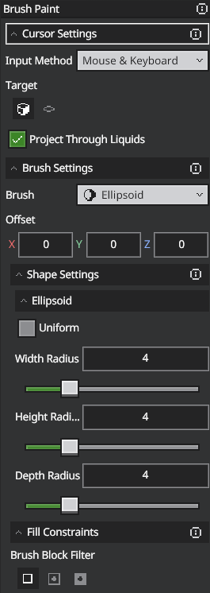
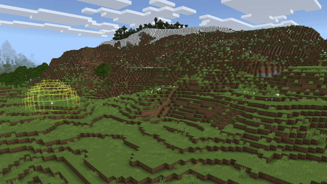
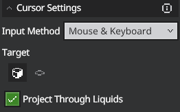
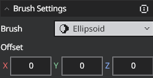
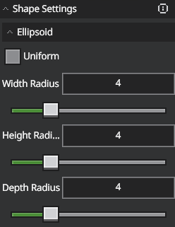
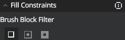
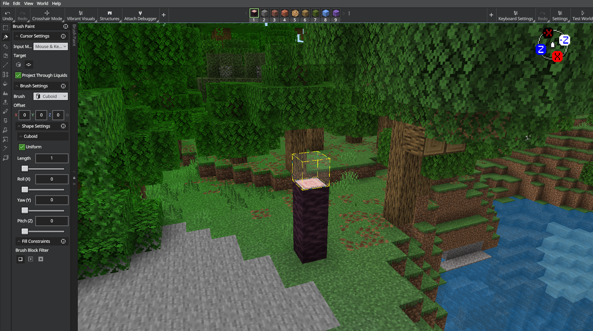
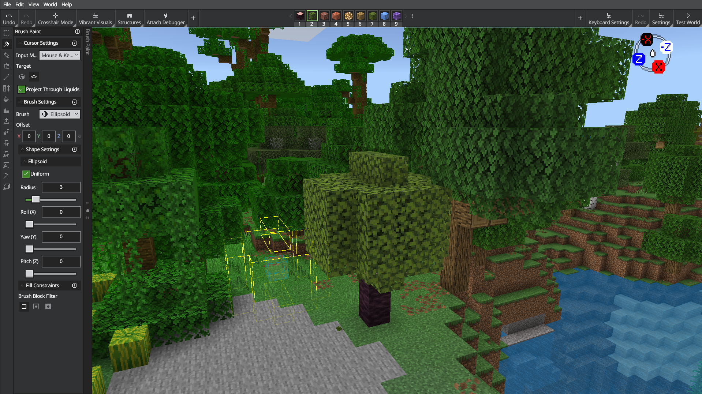

# Brush Tool

Use the Brush to paint blocks in configurable shapes and sizes. Paint a single shape with one press or continuously while holding the mouse.

Use **Shape Settings** to adjust the dimensions of the selected brush. The controls depend on the shape: a cuboid uses side lengths, while curved shapes use radius controls. For example, a cuboid with a width, height, and depth of 3 fills a 3 x 3 x 3 volume containing 27 blocks.

Click once to place one brush shape, or click and drag to paint continuously. Use this to build up features such as mountains.

## Cursor Settings

### Input Methods

- **Keyboard Only**

    Uses the directional keys to move the cursor around the world. The mouse and W,A,S,D keys are still used to move and look around the world, but they're not involved in determining block placement.

- **Mouse & Keys**

    Places blocks based on the location of the cursor. You can click and drag the mouse to create a cascade of blocks with the shape you specify across a wide area.

- **Fixed Distance**

    Places the blocks at a fixed location away from you, in the center of the Editor screen.

    > [!Tip]
    > You can use the scroll wheel on the mouse to increase or decrease the distance between you and the selection cube.
    
### Brush Target

- **Block**

    Replaces the block(s) you highlight with the cursor with Brush contents.

- **Adjacent**

    Places the blocks next to, above, or below solid blocks that you highlight with the cursor.

## Brush Settings

- ### Brush Types

    Choose a cursor with one of the five supported shapes:

    - Ellipsoid

    - Cuboid

    - Cylinder

    - Cone

    - Pyramid

- ### Offset
    
    Specify the selection's offset from the cursor location.

## Shape Settings

Here, you'll find sliders that adjust the radius of each of the Brush's axes to fine-tune the shape to suit your needs.

> [!NOTE]
> Cylinder, Cone, and Pyramid brushes also include an axis of extrusion. 

- ### Uniform

    Normalizes the depth field with the length field, resulting in a single radius/length field (regular polyhedrons) or both a length and height field (irregular polyhedrons).

- ### Width

    Defines the selection's width (X-Axis), in blocks.

- ### Height

    Defines the selection's height (Y Axis), in blocks.

- ### Depth

    Defines the selection's depth (Z Axis), in blocks.

## Fill Constraints

Block Filters determine what type of blocks are affected by the Brush action and how your selection is filled.

- ### Disabled

    Uses the type of block currently selected in the Block Picker to fill the entirety of your selection with.

- ### Mask

    Lets you specify a list of block types to exclude from the Brush action, preventing them from changing even when included in your selection.

- ### Replace

    Lets you specify what type of blocks to replace and the type of block to replace them with.

## Practice: A humble tree...

1. Move to a clear area.

2. Switch to Brush by clicking the button in the toolbar on the left of the Editor.

    > [!TIP]
    > Pressing **Ctrl+B** also switches to Brush. 

3. Choose a uniform **Cuboid** brush with a side length of 1, then use the Block Picker to choose a type of log.

4. Find a clear place on the ground and place one log block.

5. Place some more log blocks on top of each other to create a tree trunk.

    

6. Choose a uniform **Ellipsoid** brush with a radius of 3, change the block type to leaves, then click the top of your log stack to put leaves around the top of your tree.

    

## Keyboard shortcuts

For the full list, see [Editor Hotkeys](../BedrockEditor/EditorKeyboardInputs.md).

| Name | Shortcut |
|:----|:----|
| Brush Tool | Ctrl+B |
| Paint at Cursor (one‑shot) | Enter |