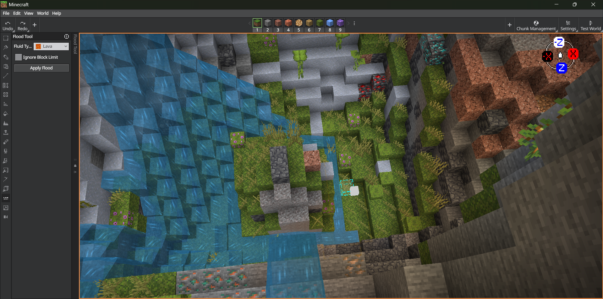
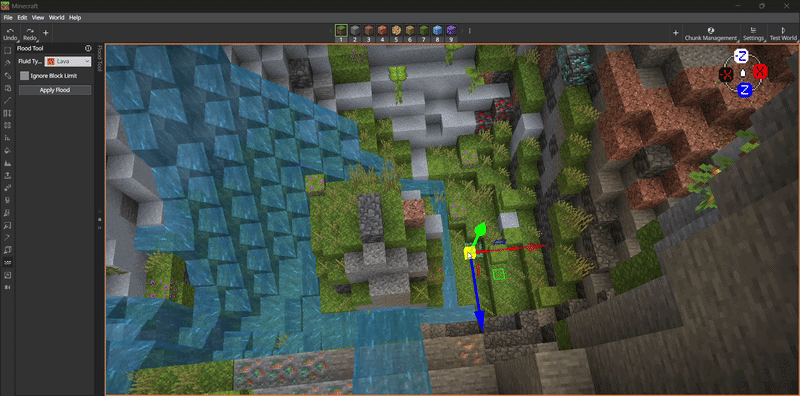
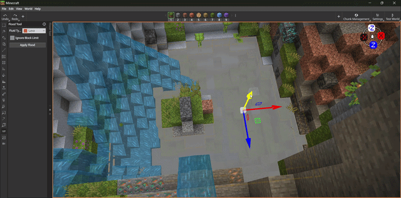
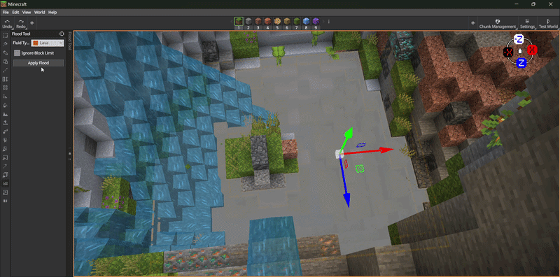

# Flood Tool

The Flood Tool fills areas of your world with water or lava. Click a surface block to place a water level indicator, then raise or lower it to control the fluid height. The tool uses a breadth-first search to calculate which blocks the fluid will reach, respecting terrain boundaries and block-level waterlogging.

## Using Flood

1. Select Flood by clicking the button in the tool rail on the left side of the Editor.

   > [!TIP]
   > The default Flood shortcut is **Ctrl+Shift+F**.

2. Choose a **Fluid Type** (Water or Lava) in the tool settings pane.
   

3. Click a surface block in the world. An air block above a solid block is required to place the water level indicator. A gizmo widget appears at the clicked location showing the current flood level.
   

   > [!NOTE]
   > If Editor can't establish a valid liquid level at the selected location, it displays an error and does not apply a flood. Select an air block above a solid block and try again.

4. Use **Page Up** and **Page Down** to raise or lower the water level indicator. The tool recalculates the flood area each time you adjust the level.
   

   > [!NOTE]
   > A bounding box shows the calculated flood extent. If the search reaches its limit, the preview is truncated. **Allow Partial Fill or Drain** allows you to apply that partial result; it doesn't remove the search limit or include the excluded area.

5. Press **Ctrl+F** or click **Apply Flood** to commit the flood. The button tooltip displays the keyboard shortcut for quick reference. A progress dialog shows the operation status.
   

   > [!NOTE]
   > The flood operation supports undo. If you need to revert, use **Ctrl+Z**. Moving the water-level preview also supports undo/redo; this doesn't mean every preview setting change is undoable.

## Limits

| Limit               | Value                                          |
| :------------------ | :--------------------------------------------- |
| Maximum search size | 120,000 unique search cells |
| Horizontal search region | 1,024 blocks wide, centered around the origin and aligned to chunks |

The search-cell limit isn't a guarantee that an operation can fill exactly 120,000 blocks. When the search is truncated, inspect the preview before enabling **Allow Partial Fill or Drain**.

## Keyboard shortcuts

For the full list of Editor shortcuts, see [Editor Hotkeys](../BedrockEditor/EditorKeyboardInputs.md).

> [!NOTE]
> The water-level and apply commands work while Flood is active.

| Command                      | Shortcut         |
| :--------------------------- | :--------------- |
| Activate Flood Tool          | **Ctrl+Shift+F** |
| Raise water level            | **Page Up**      |
| Lower water level            | **Page Down**    |
| Delete water level indicator | **Ctrl+D**       |
| Apply flood                  | **Ctrl+F**       |
