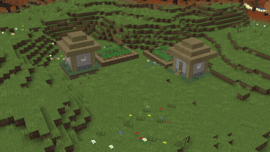
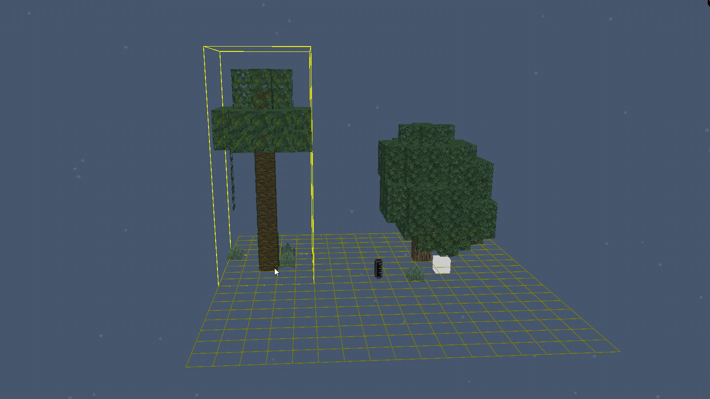
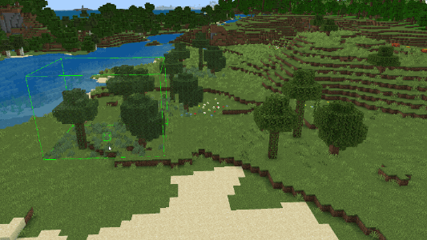

# Layouts

Layouts let you arrange saved structures into reusable groups and place instances of those groups in your project. For example, combine a house, a garden, and a tree into a layout, and then place that layout in several locations.

Until you bake an instance, it remains linked to the layout. Baking converts the instance into world blocks and removes that link. Before baking, changes to the layout or its underlying structures update the linked instances, so you don't have to replace each copy manually.

## Create a layout

1. Save the structures you want to reuse in the [Structures panel](EditorStructures.md).
1. Open **Layouts Management** from the Action Bar, or open it from the **Layouts** tool. If it isn't on your Action Bar, use **+** to add it.
1. Select **New Layout** to open the **Layout Editor**.
1. Choose an existing structure from the structure dropdown, position it with the cursor, and click to add it to the layout.
1. Add more structures as needed. Select a structure in the layout to reposition or mirror it, change which structure it uses, or remove it.

## Place and edit instances

1. Select **Layouts** from the tool rail.
1. Set **Mode** to **Place** and choose a layout.
1. Click in the world to place an instance.

After placing one instance, the tool switches to **Edit** mode. Enable **Continuous Placement** to stay in **Place** mode and place multiple instances.

In **Edit** mode, select a placed instance to adjust its transform, rotate it, mirror it, or access its layout. Editing the shared layout updates its linked instances; changing one instance's placement changes that instance.

The **Layouts** tool and **Layouts Management** panel don't have default activation shortcuts. You can configure shortcuts in [Keyboard Settings](EditorKeyboardInputs.md).

## Bake an instance into blocks

Baking writes an instance into the world as blocks and removes its link to the layout. Later changes to the layout or its structures no longer update that baked copy.

1. In the **Layouts** tool's **Edit** mode, select an instance.
1. Select **Bake**.
1. Review the **Bake Layout Instance** confirmation before continuing.

> [!WARNING]
> Manually baking a layout instance can't be undone. Export a **Backup Editor Project** before baking if you need to preserve an editable, linked version.

The animation uses an earlier confirmation label. In U6, the command is **Bake** and the confirmation is **Bake Layout Instance**.

## Export a project that contains layouts

World export bakes layout instances into the exported world so that players can use it outside Editor. This doesn't permanently bake the linked instances in your working project.

Select **File** > **Export**, and then choose **Backup Editor Project** to preserve the editable project without baking its layouts. For export types and the differences between playable worlds and project backups, see [Editor Workflow](EditorWorkflow.md).
