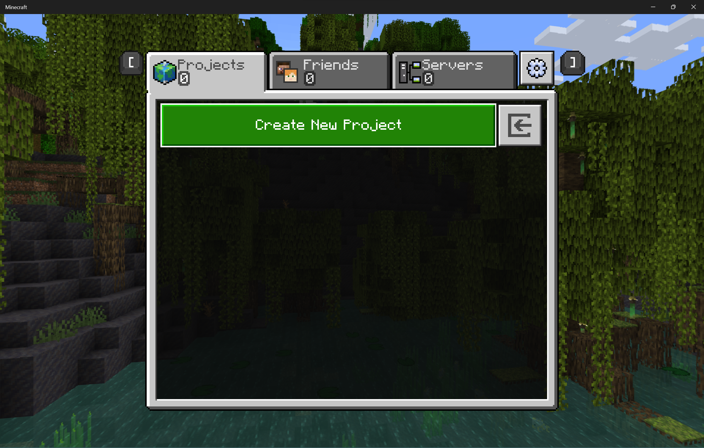
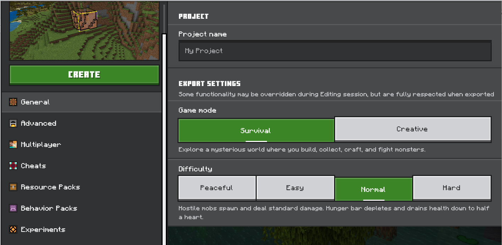

# Editor Overview

This overview introduces Editor projects, the Editor interface, and its tools. For keyboard shortcuts, also known as keybindings, see [Control Help](EditorControlHelp.md), each tool's guide, or [Editor Hotkeys](EditorKeyboardInputs.md).

For a more in-depth experience using the tools to accomplish basic tasks, take a look at the [Editor Tutorial](EditorTutorial.md).

There's more information about Editor on the [Minecraft: Bedrock Editor GitHub site](https://github.com/Mojang/minecraft-editor)!

> [!NOTE]
> Images in this document may vary slightly from what you have on your screen.

In this manual, you will learn the following:

> [!div class="checklist"]
>
> - What the difference is between a project and a world
> - How to create a project
> - How to adjust the Editor interface
> - How to navigate in Editor
> - Where to learn about exporting a playable world and backing up a project

## Requirements

To get started, you need the following:

- A Windows 10 (or higher) computer with Minecraft Bedrock Editor
- Keyboard and mouse

> [!IMPORTANT]
> Editor is PC only, and not available on mobile or console.

It's recommended that the following be completed before beginning this tutorial.

- [How to get Minecraft Bedrock Editor](EditorInstallation.md)

## Editor projects and playable worlds

An **Editor project** is a world you work on in Editor. It contains the world you're building as well as Editor-specific data, such as data used by Editor extensions. Projects appear in Editor rather than in the usual list of playable Minecraft worlds.

To play your work as a regular Minecraft world, export the project as **Playable World** to create a local playable copy. To share it, choose **Shareable World (.mcworld)** to create an archive. Exporting creates a separate world for gameplay; it doesn't replace your Editor project. The playable export does not include Editor-specific data or Editor extensions, so keep the project if you want to continue editing with those features. To share or back up an editable project, choose **Backup Editor Project** to create an `.mcproject` archive instead. See [Editor Workflow](EditorWorkflow.md) for import and export steps.

## Creating an Editor project

After you launch Editor, you get a screen that says "Create New Project."



While you're creating a project, you can configure the name, export settings, and the usual settings for a Minecraft world.

Export settings apply when you export a playable world or shareable world archive from Editor.



New projects load with a Welcome screen. If you close it and you want it open again, go to the **Help** menu and select **What's New**.

> [!TIP]
> The **What's New** panel shows information about the latest Editor update, including new tools and features.

## First Things First: UI Settings

Editor looks like your usual Minecraft game with a user interface (UI) on top of it. Before we get started, let's make sure that UI looks okay for your monitor resolution and preferences.

Select **File** > **Settings**, and then expand **Interface**.

> - UI Scale - Makes the menu bar and windows larger or smaller in relation to the project world.
> - Font - Changes the size of the text in the windows.
> - Theme - Changes the colors used in the UI.

Changes to these settings are reflected immediately.

Editor works with [Minecraft Accessibility](https://www.minecraft.net/accessibility) features.

When you're happy with the appearance, close the Settings panel. See [Editor Settings](EditorSettings.md) for navigation, sound, and world-view options.

## Editor UI Windows: Move, Minimize, Close

You can move Editor windows by clicking and dragging them by the title bar.

Click the double "up arrows" in the corner to collapse the windows upwards so you can tuck them out of the way if you don't want to close them.

If a floating window has more tabs than fit on one page, use the mouse wheel over the tabs to move between pages.

If you do want to close the window, click the X in the corner. Some windows can be re-opened with a keyboard shortcut.

## What's New

Open **Help** > **What's New** to learn about Editor updates. The U6 update introduces [Layouts](EditorLayouts.md), which lets you arrange saved structures into reusable groups and place linked instances throughout your project.

Tools are on the left tool rail. Open a tool's information panel to learn how to use it, or press **F1** for [Control Help](EditorControlHelp.md). Use the **+** buttons to customize your [Action Bar](EditorActionBar.md).

The block hotbar is separate from the Action Bar. Select a slot to change the active block, or double-click a slot to open the Block Picker.

For more help, see the [Editor documentation](https://aka.ms/BedrockEditorDocs), [feedback site](https://aka.ms/BedrockEditorFeedback), and [Editor Community](https://aka.ms/BedrockEditorCommunity).

## Movement

Before we dive into the Tool Mode UI, you might want to take a moment to familiarize yourself with how to look around and move around in the different modes.

- Unlock the camera: In Tool mode, hold down the right mouse button to look around. In Crosshair Mode, you do not need to hold down the right mouse button.

- Moving around: In Tool Mode, hold the right mouse button and use **W**, **A**, **S**, and **D** to move horizontally, **E** to move up, and **Q** to move down. Crosshair Mode uses Minecraft's gameplay controls instead; review them in **Settings** > **Controls** > **Keyboard & Mouse**.

- Movement speed: Select **File** > **Settings** > **Control** and adjust **Move Speed Multiplier**. In the viewport, **Shift+E** increases speed and **Shift+Q** decreases it. See [Editor Settings](EditorSettings.md).

- Look-to-teleport: In Tool Mode, point your cursor at a block in the distance, and hit `G` on your keyboard. You will be "Grapple teleported" there. This function does not work in Crosshair Mode.

- Directional Compass: In the upper-right corner of the editor window, the directional compass will show you which cardinal direction you are facing. You can even click a direction to snap your view to face it.

- Viewport gizmos: Move, resize, and rotation gizmos maintain a consistent size on screen as you move the camera, so their controls remain selectable from a distance.

To see the general shortcuts and the shortcuts for your active tool, press **F1** to open [Control Help](EditorControlHelp.md).

## Editor and Bedrock Dedicated Server

Editor is enabled in the Windows version of Bedrock Dedicated Server.
There are two ways to launch it:

### Launch editor from the command line

Open a terminal window and run the following command:

`bedrock_server.exe Editor=true`

This will only work if you're launching Dedicated Server from scratch with no existing world.

You should see the output say:

```
#####################################################
#                                                   #
#              CREATING EDITOR PROJECT              #
#                                                   #
#####################################################
```

### Create an Editor project from Minecraft

1. Launch Editor from the usual desktop shortcut.
1. Create a new Editor Project.
1. Locate the Editor Project in the **com.mojang/minecraftWorlds** folder and copy it into the Dedicated Server worlds folder
1. Ensure that `server.properties` has the correct world name.
1. Execute **bedrock_server.exe**.

If correctly set up, you should see the output say

`[2023-10-24 07:21:43:977 INFO] Enabling Editor Services`

Editor Mode is controlled by a flag in the level data (not by the command line), so you need to launch the server either by having the server create a new Editor project, or by launching the server using an existing Editor project.

When the server is up and running, any client connections from Minecraft Bedrock Edition will connect as editor sessions and present the editor interface. Clients must match the server’s edition/version&mdash;mismatched clients will be refused.

## What's Next?

Now that you know more about the parts of Editor, let's use the tools to do some editing!

> [!div class="nextstepaction"]
> [Editor Tutorial](EditorTutorial.md)
