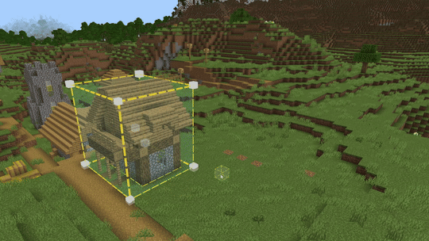
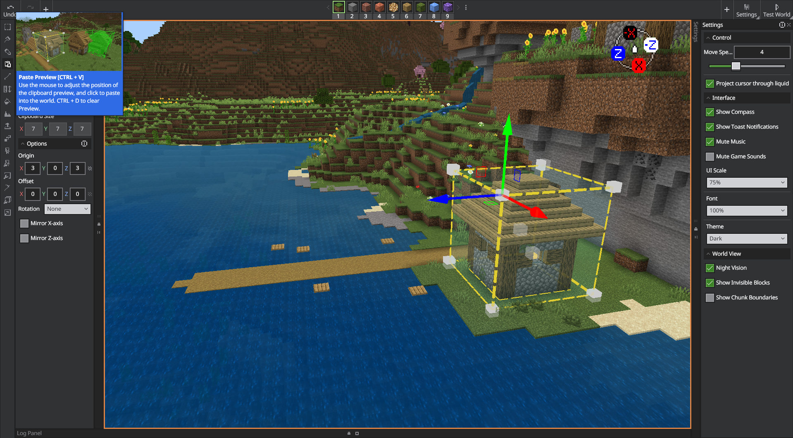
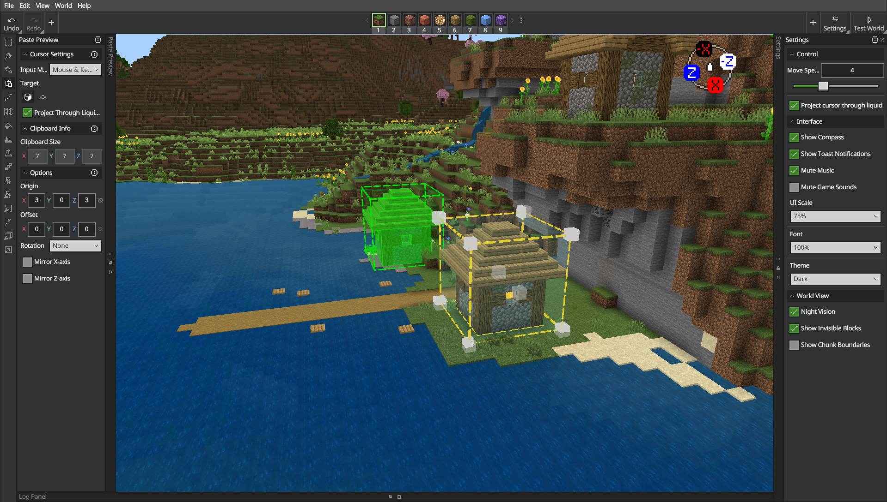
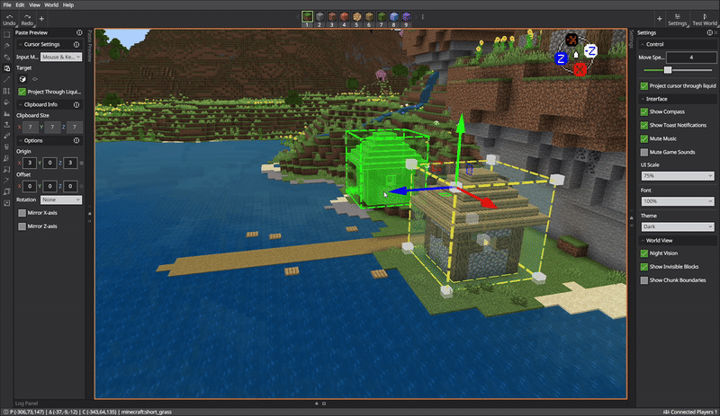
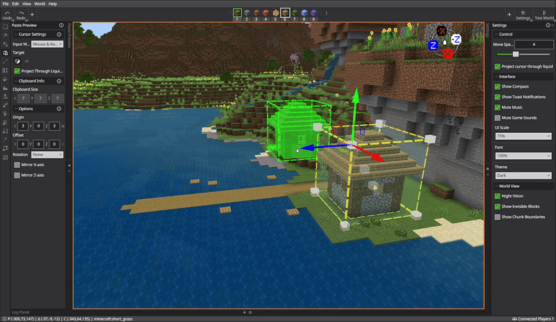

# Paste Preview

Paste Preview lets you position, rotate, mirror, and offset your clipboard contents before committing the paste. Open it after Copy or Cut to get an interactive preview with precise controls, keyboard nudges, and a move gizmo.

Paste Preview has two modes:

- **Paste**: The preview follows the cursor. Click or press **Enter** to paste.
- **Move**: The preview freezes in place so you can reposition it with the move gizmo or exact coordinates. Switch between modes by pressing **M**.

## Get started

1. Select something interesting, like a village house, with any of the selection modes.
    

2. Copy or cut the selection (**Ctrl+C** or **Ctrl+X**).

3. Open Paste Preview (**Ctrl+V**). Paste Preview starts in **Paste** mode.

4. Hover over the ground where you want the copied or cut blocks to be pasted. A preview appears with an outline of the clipboard item.
    

5. To position the preview precisely, select **Move** or press **M**. Drag the move gizmo, enter exact **Position** coordinates, or nudge the preview with the keyboard (see shortcuts).
    

   > [!TIP]
   > Viewport gizmos maintain a consistent size on screen, so the move gizmo remains selectable when the camera is far from the preview.

6. Press **Enter** to place the blocks. To place them with the mouse, select **Paste** or press **M** again, and then click the viewport.
    

    > [!TIP]
    > You can Transform your copied selection by editing the Origin coordinates, Rotating the selection, or mirroring the selection along the x or z axis.

### Placement control pane

- **Mode**: Switches between **Paste** mode, where the preview follows the cursor, and **Move** mode, where the preview stays in place and displays the move gizmo and position fields.

- **Position**: Sets the preview's world coordinates while in **Move** mode.

- **Origin**: The placement anchor in world coordinates; rotations and mirror actions pivot around this point. Editing X/Y/Z moves the preview anchor.

- **Offset**: Defines an additional offset from the placement point to the clipboard item's internal origin.

- **Rotation**: Rotates the preview in 90° increments (0°, 90°, 180°, 270°).

- **Mirror X‑axis / Mirror Z‑axis**: Reflects the preview around the X or Z axes.

- **Clipboard Size**: Shows the dimensions of the current clipboard item.

## Keyboard shortcuts

These shortcuts work while the Paste Preview is active. For the full list of shortcuts, see [Editor Hotkeys](../BedrockEditor/EditorKeyboardInputs.md).

|Command|Shortcut|Alternate|
|:---|:---|:---|
|Open Paste Preview|**Ctrl** + **V**|-|
|Toggle Paste/Move mode|**M**|-|
|Commit paste|**Enter**|**Ctrl** + **V**|
|Move Origin (anchor)|**Ctrl** + **Up/Down/Left/Right**|**Ctrl** + **Page Up/Page Down**|
|Nudge Offset (relative)|**Ctrl** + **Shift** + **Up/Down/Left/Right**|**Ctrl** + **Shift** + **Page Up/Page Down**|
|Rotate clockwise 90°|**R**|-|
|Rotate counter‑clockwise 90°|**Shift** + **R**|-|
|Mirror X‑axis|**Ctrl** + **Shift** + **X**|-|
|Mirror Z‑axis|**Ctrl** + **Shift** + **Z**|-|

## Tips

- Use origin for world‑space placement and offset for fine, relative alignment.

- If the clip seems to pivot oddly, check the origin rotation and mirror use it as the pivot.

- For large structures, pick a stable anchor (like a corner) before rotating.
