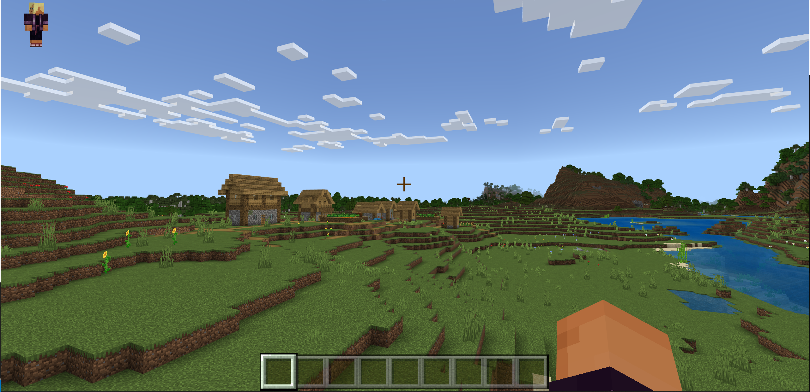
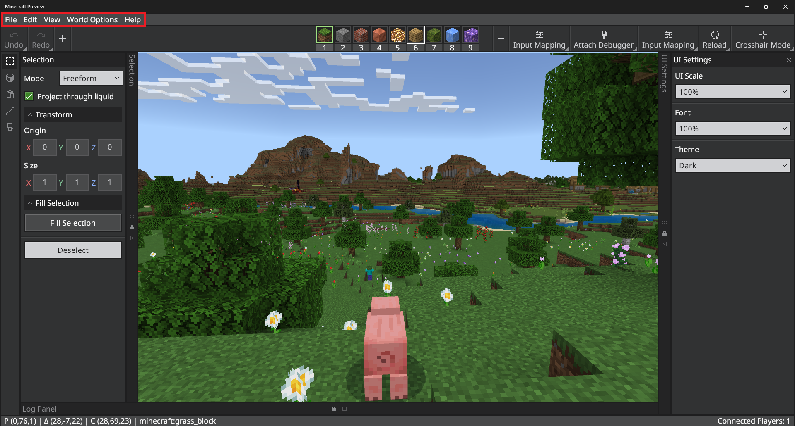
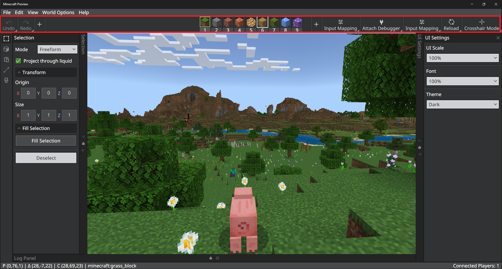
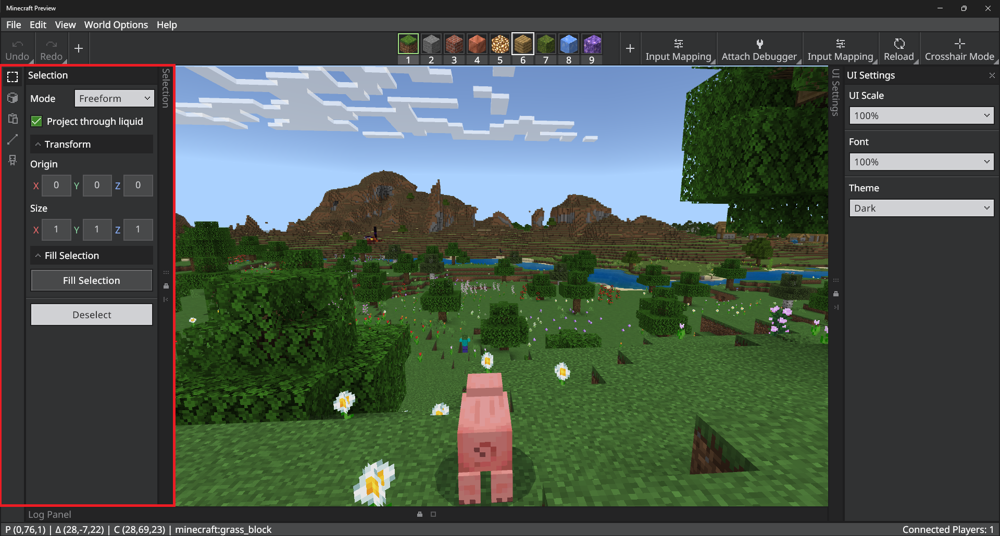
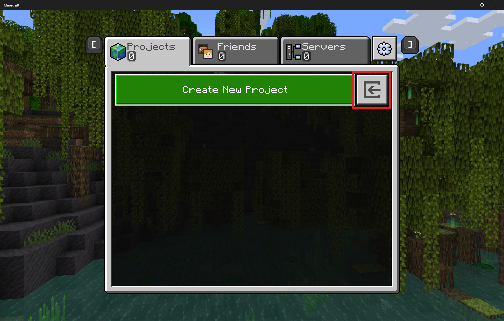

# Tool Mode and Crosshair Mode

The two modes within Editor are Tool Mode and Crosshair Mode.

**Tool Mode** has multi-block editing tools and the user interface. When you move the mouse without holding any mouse buttons, your cursor is freely available to use the user interface.

**Crosshair Mode** has more precise, single-block editing capabilities. It also uses the usual Minecraft keybindings you can see on the Settings > Controls > Keyboard & Mouse screen. Move the mouse to look around.

In **Tool Mode**, hold the right mouse button to look around and navigate with **W**, **A**, **S**, **D**, **E** (up), and **Q** (down). These are Editor viewport controls, not Crosshair Mode's gameplay bindings.

In a new project, before you touch anything, you are in Tool Mode.

Press **Esc** in Crosshair Mode to return to Tool Mode. In Tool Mode, **Esc** can have a tool-specific effect, such as releasing an anchored Primitives preview.

> [!TIP]
> In the top right corner of the screen, select the "Crosshair Mode" button or press **Ctrl+Tab** to go into Crosshair Mode. Note the differences. To go back to Tool Mode, you can press **Ctrl+Tab** again or press **Esc**. You can also go from Tool Mode to Crosshair Mode by clicking the Crosshair Mode button in the upper right corner.

Think of the Tool Mode UI as a collection of containers. The menu bar contains menus. The action bar contains buttons that do simple functions like Undo and Redo. The toolrail contains more complicated tools that have their own configuration windows where you can change the settings.

> [!NOTE]
> The contents of these containers may change between versions of Editor.

**Menu bar**: Located at the top of the screen. It includes the File, Edit, View, World, and Help menus.

**Action bar**: Located below the menu bar. Add shortcuts for common actions with the **+** buttons. Its contents depend on your configuration. See [Editor Action Bar](EditorActionBar.md).

**Toolrail**: Located on the left side of the screen. It contains Editor tools such as Selection, Brush, Primitives, Paste Preview, Line, and Summon. You can also select tools using keyboard shortcuts, when available. If the tools span multiple pages, use the mouse wheel over the tool rail to move between pages.

Use the [Layouts tool](EditorLayouts.md) to place reusable groups of structures. Add **Layouts Management** to the Action Bar to create and manage layouts.

## Menu bar

### File

#### Export
When you're ready to play your local project outside Editor, select **File** > **Export**, choose **Playable World**, and select **Export**. This creates a local playable world directory. Choose **Shareable World (.mcworld)** for an archive, or **Backup Editor Project** for an editable `.mcproject` backup. See [Editor Workflow](EditorWorkflow.md) for file locations.

> [!NOTE]
> If you don't know how to find your com.mojang folder, there are instructions in the Bedrock [Getting Started](../GettingStarted.md) tutorial.

Editor has its own file type for projects: .mcproject. These files always open in Editor if it's installed on your computer. To **import** projects from the editor screen, select Create New Project, then click the button to the right of Create New Project.

Navigate to a .mcworld, .mctemplate, or .mcproject file.
After the file is imported, it is converted to an .mcproject file.

Visit [Minecraft File Types](../MinecraftFileExtensions.md) to learn more about Minecraft file types like .mcproject and .mcworld.

- **Settings** - Opens **Control**, **Interface**, and **World View** settings. Change the movement speed multiplier under Control, UI Scale/Font/Theme under Interface, or chunk boundaries and other visualization options under World View. See [Editor Settings](EditorSettings.md).

- **Keyboard Settings** - Opens Input Mapping so you can review and customize shortcuts.

- **Game menu** - Brings up the menu where you can Resume Editing, go into Minecraft settings, or Save & Quit.

### Edit

These are some of the main functions you'll use as you work in Tool Mode.

|Command  |Shortcut  |
|:-------|:---------|
| Undo | `Ctrl+Z` |
| Redo | `Ctrl+Y` |
| Quick Fill | Select an area and either `Ctrl+F` while in Selection mode or use Fill in the Selection panel |
| Deselect | `Ctrl+D` or use the Deselect button in the Selection panel |
| Delete | `Delete` |

Check out our other guide for a complete list of the [Bedrock Editor hotkeys](EditorKeyboardInputs.md).

### View

- **Log Panel** (`Ctrl+H`)

- **Navigation Logging** - Toggles this feature on or off.

- **Vibrant Visuals** - Opens the Vibrant Visuals Settings panel.

- **Structures** - Opens the Structures panel.

### World

- **Pause**

- **Dimensions** - Change dimensions or open the Dimensions Panel.

- **Test World** 

- **Time of Day Settings**

- **Navigation Panel**

- **Weather**

- **Biome Data Assignment** - Opens the Fill Biomes tool.

For more information about World Options, take a look at [Editor World Options](EditorWorldOptions.md).

### Help

- **What's New**: Select this to reopen the welcome menu and view the latest Editor changes.

- **Control Help**: Opens a context-sensitive list of general and active-tool shortcuts.

- **Documentation**: A quick link to our Editor documentation.

- **Feedback**: Links to the public GitHub repository where you can share feedback directly with our team!
