# Editor Tutorial

This tutorial is intended to guide you through using Minecraft Bedrock Editor to accomplish a variety of tasks. Before you begin, you should know how to launch Editor, create a project, move around, and switch between the two modes.

> [!NOTE]
> Images in this document may vary slightly from what you have on your screen.

## Requirements

To get started, you need the following:

- A Windows 10 or later computer with Minecraft Bedrock Editor
- Keyboard and mouse

> [!IMPORTANT]
> Editor is not available on mobile.

It's recommended that the following be completed before beginning this tutorial.

- [How to Get Minecraft Bedrock Editor](EditorInstallation.md)

- [Bedrock Editor Overview](EditorOverview.md)

In this tutorial, you're going to learn how to build the Arc de Triomphe and instantly duplicate the structure to edit a world at massive scale. You'll only need two types of quartz block and a block of your choice to use as a visual guide.

> [!VIDEO https://www.youtube.com/embed/LyumuBINeCc]

## Make the monument
1. Launch Minecraft Editor and find a relatively flat spot in the world.

2. Open the Selection tool, choose **Marquee**, and enable **2-Point Selection**. This tutorial uses a click to choose the first corner and **Shift+click** to extend to the opposite corner. Delete a rectangle of terrain at least 99 x 99 blocks where you want to build the Arc de Triomphe.
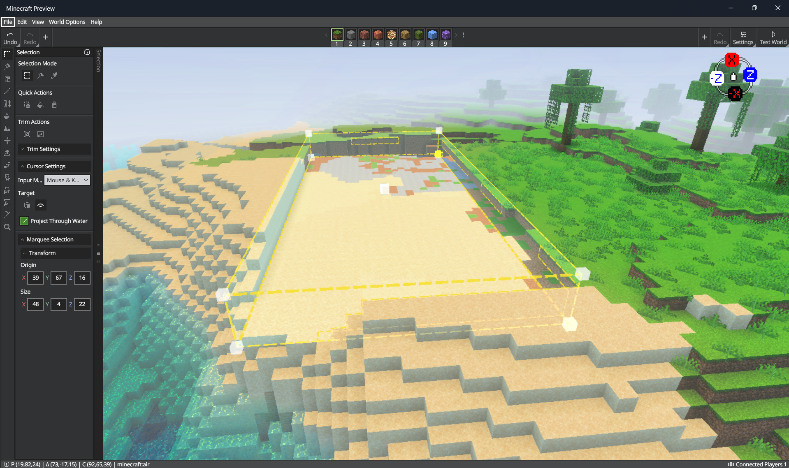

3. Use the Selection tool to create a 23 x 30 x 23 rectangular prism.
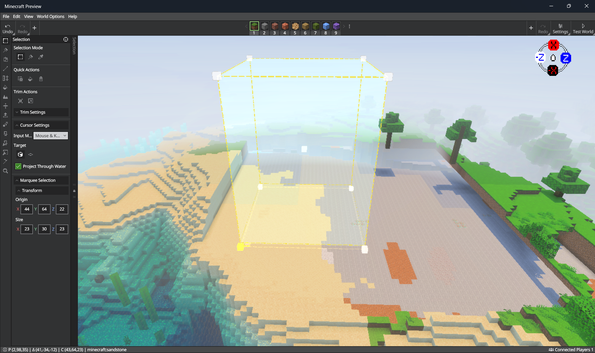

4. Double-click a block on the block picker and choose a quartz block, then press **CTRL**+**F** to fill the selection.

5. Change your target to Adjacent if it's not already, then select the top of one of the corner blocks of the monolith.
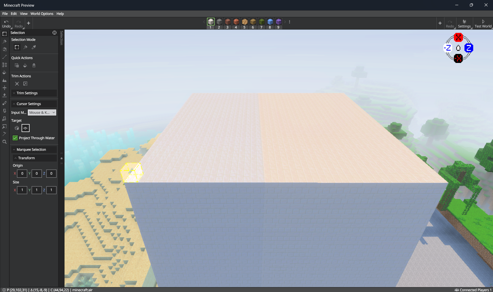

6. Hold **Shift** and click the corner block diagonal from the one you selected in the last step, then expand the selection one block along the X and Z axes on both corners. Fill the selection.
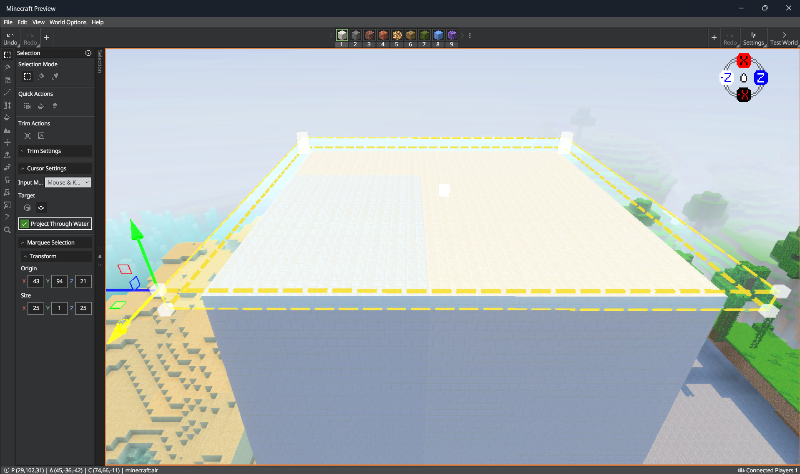

7. Select the top of the monument's corner block and use the Repeater to create a grid that repeats 12 times along the X and Z axes only.
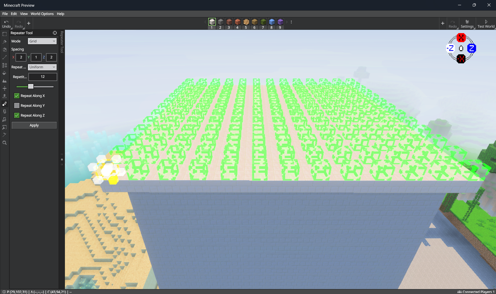

8. Change the X and Z axis spacing to 2, then place the selection.

9. Use the Selection tool to delete all but the outermost repeated blocks, creating a border around the top of the monument.
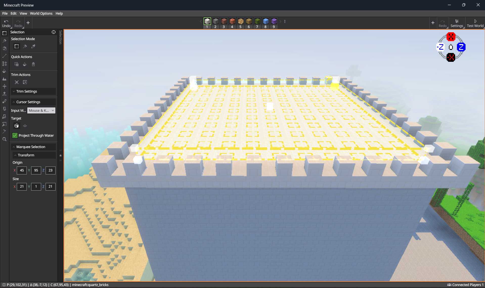

10. (Optional) Select a line of 12 blocks from the bottom corner towards the center with a different block type of your choosing. Repeat the process vertically from the horizontal center point of the monument to mark the center block.
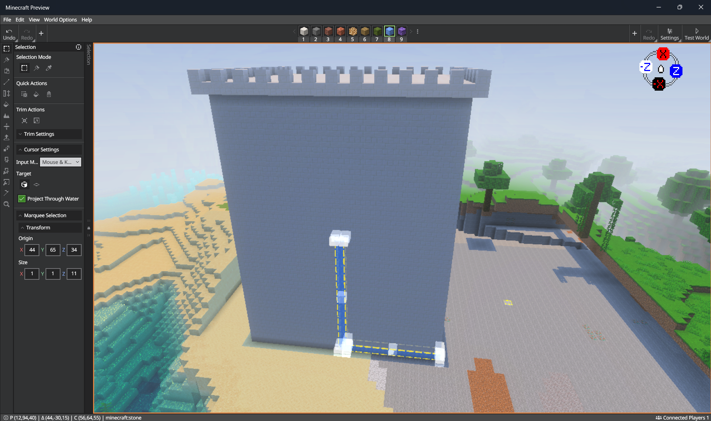

11. (Optional) Select and copy the blocks that make up the guides and use Paste Preview to rotate and copy the selection on all four faces of the monument.

12. Use the Block Picker to choose quartz stairs.

13. Use the Selection tool and change your target to Adjacent to select the corner block beneath the overhang at the top of the monument.

14. Select a white corner of the selection to show its resize gizmo. Drag the horizontal axis handle to the opposite corner, then press **Ctrl+F** to fill the selection.
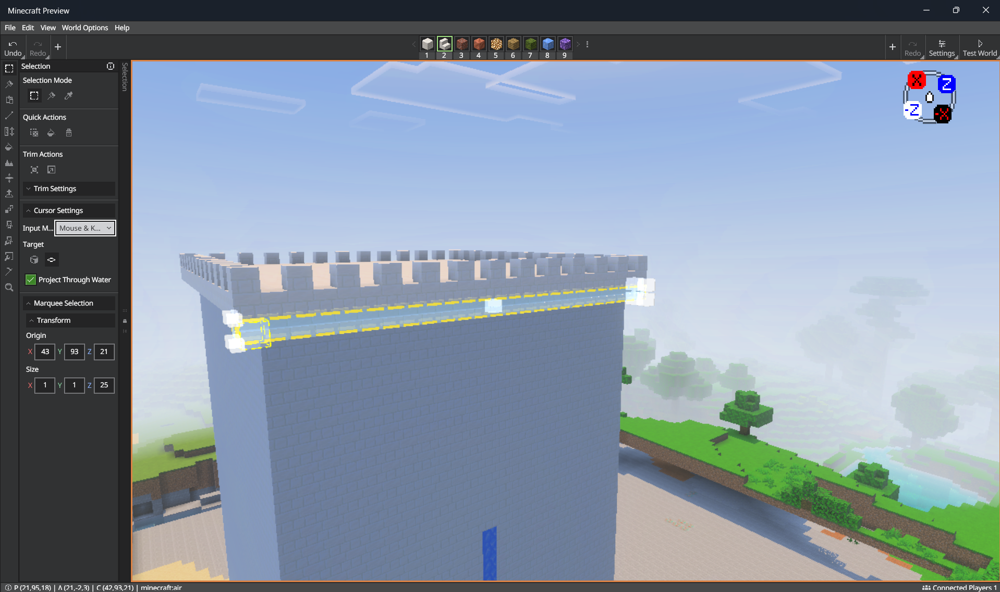

15. Use the Workbench to hover over the stairs and **Ctrl**+**Shift**+**Click** to properly orient them.

16. Copy the stairs and use Paste Preview to place a row of stairs at the bottom and near the center of the monument face.

17. Use the Workbench to hover over the bottom row of stairs and **Ctrl**+**Shift**+**Click** to properly orient them.

18. Use the Selection tool and change your target to Block to select and copy the three rows of stairs you just placed.

19. Use Paste Preview to copy the selection to the opposite face, then rotate the selection 90 degrees to repeat the process on the remaining two faces.

## Carve the arc
1. Choose **Air** from the Block Picker, then open [Primitives](EditorPrimitivesTool.md) and select **Cylinder**. Disable **Hollow** so the entire cylinder is filled with air.

2. Set the cylinder's radius to 6 and **Height** to 23. If **Uniform** is disabled, set both the width and depth radii to 6. Height is the cylinder's length along its local Y axis.

3. Rotate **Roll (X)** by 90 degrees for a tunnel along the world's Z axis, or **Pitch (Z)** by 90 degrees for a tunnel along the world's X axis.

4. Click to anchor the preview, then use the move gizmo to align the top of the cylinder with the desired arch apex. Verify that it passes through both faces of the monument. Adjust its height or placement if necessary before selecting **Place Blocks**.

5. Switch back to Selection and choose **Block** targeting. Select a rectangular volume below the circular opening, extending down to the ground and through the monument. Keep its width aligned with the opening.

6. Select **Delete** in the Selection tool to clear the lower part of the opening and complete the arch.
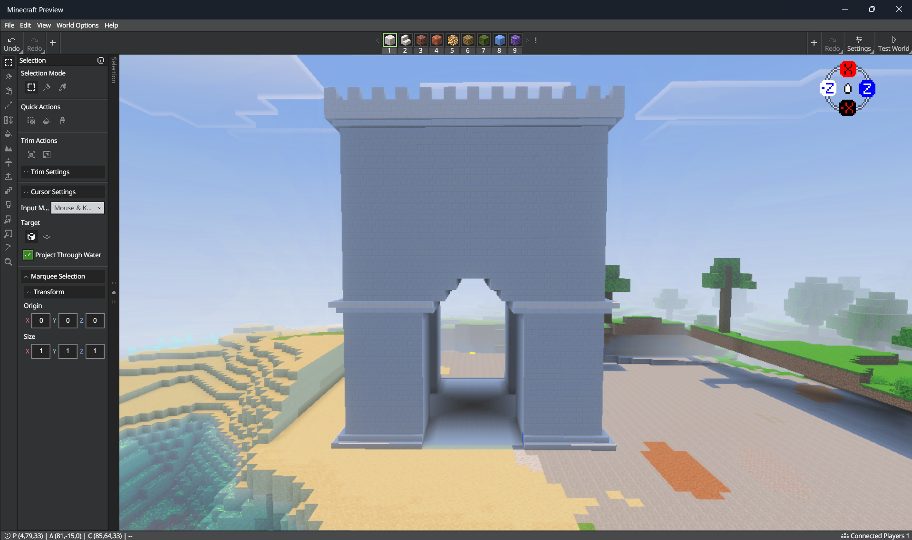

7. Repeat for the perpendicular pair of faces. Reset the primitive's rotation before rotating it onto the other axis, and verify the preview before placing.

## Add some detail
1. Use the Block Picker to select quartz blocks, then use the Selection tool with your target set to Adjacent and place a rectangle that fills the space above the arc.

2. Switch your target to Block, then select and delete the interior quartz blocks of your new rectangle to create a border.
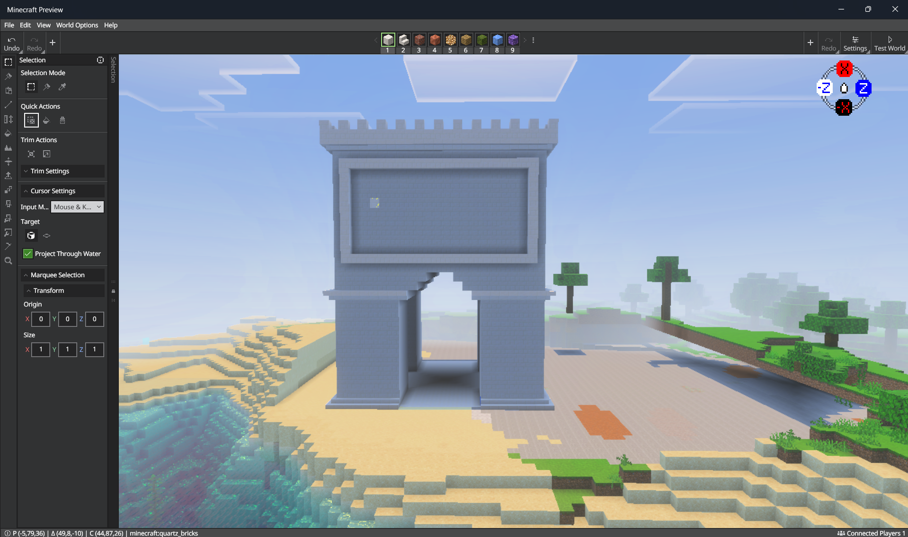

3. Set your target back to Adjacent, then place a border in one of the spaces on either side of the arc. 

4. Copy the smaller border and use Paste Preview to paste it on the other side of the monument.

5. Set your target to Block and select all three borders, then use Paste Preview to place the selection on the remaining three faces.
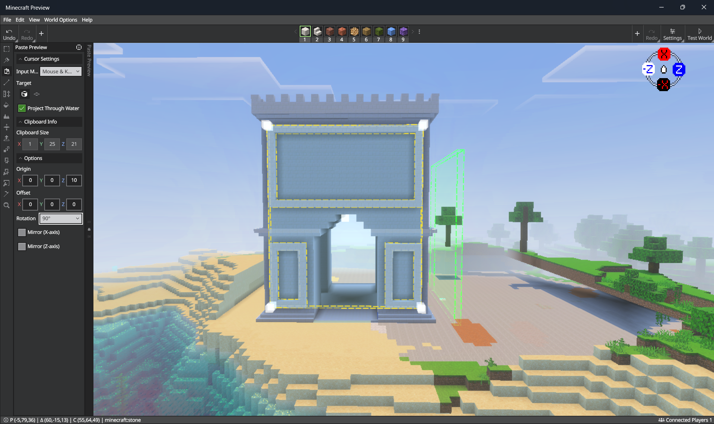

6. Use the Pencil tool with **Draw Type** set to **Block** and **Edit Mode** set to **Draw**, then add individual block details inside the borders of your Arc de Triomphe.
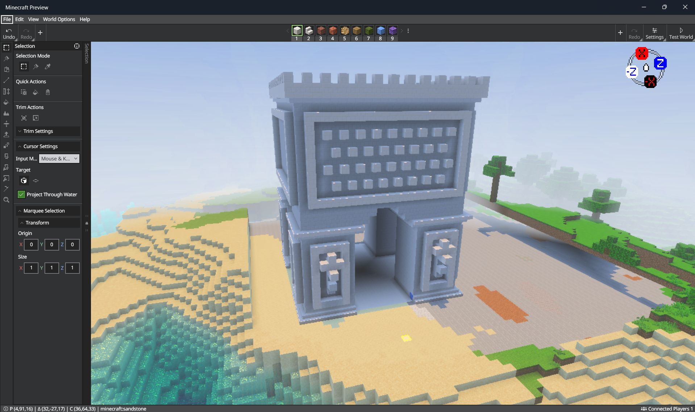

## What's Next?
Select the entire structure, then use the Repeater to build at a massive scale!
