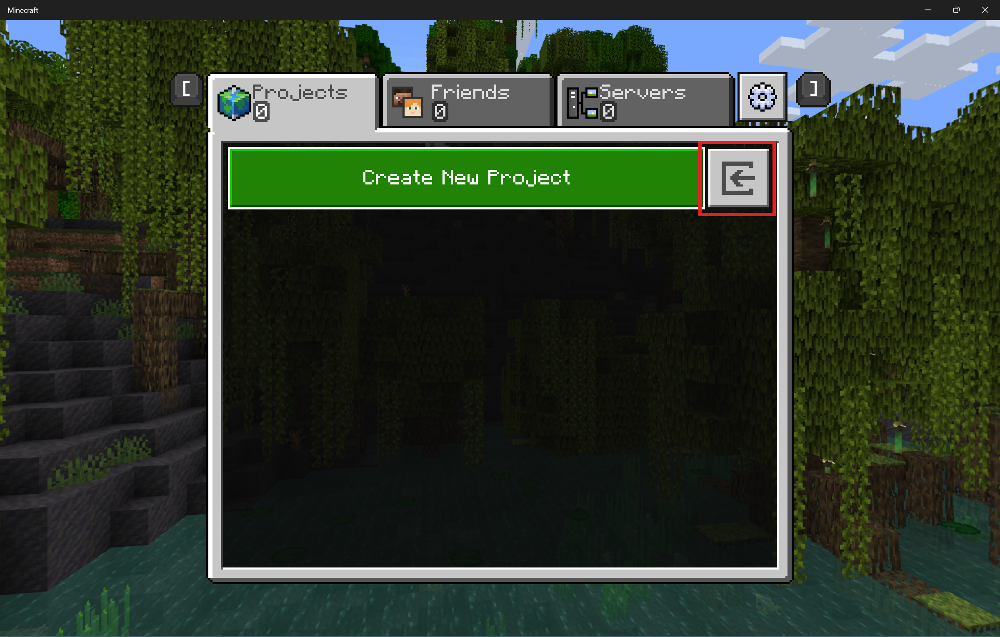
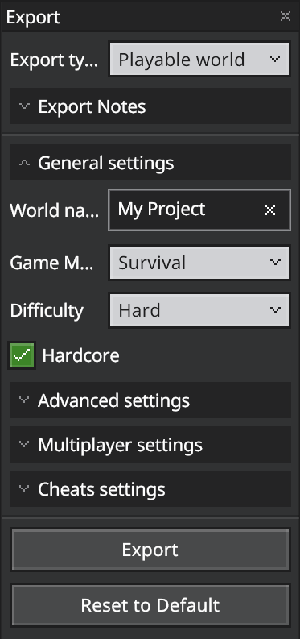
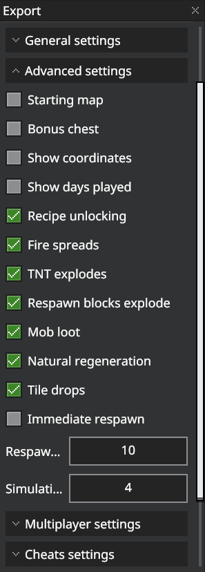
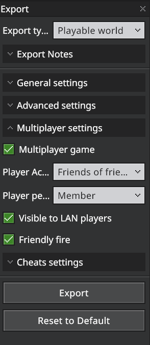
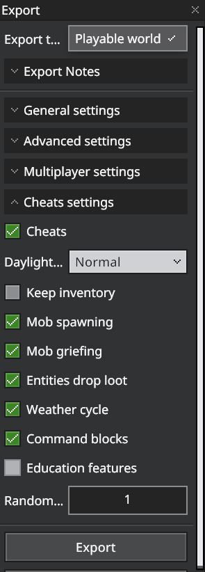

# Editor Workflow

An Editor project is an editable world with Editor-specific data. Exporting a playable world creates a separate copy for gameplay without Editor-specific data or Editor extensions. Choose **Playable World** for a local world directory or **Shareable World (.mcworld)** for an archive. To preserve Editor-specific features for future editing, keep your project or use **Backup Editor Project** to create an `.mcproject` archive.

In this guide you'll learn the following:

> [!div class="checklist"]
>
> - How to create a new project
> - How to export a playable world
> - How to back up an editable project
> - How to import projects/worlds into Editor.
> - How to use and navigate the export panel

> [!NOTE]
> Export, Test World, and Publish to Realms are local-project workflows. These commands aren't available while editing a project hosted on Realms or a Bedrock Dedicated Server.

## Create a project

1. Launch Minecraft Bedrock Editor.

2. Select **Create New Project**.

3. Name and open the project.

4. (Optional) Select the brush tool (`Ctrl+B`) and draw something by clicking on the ground a few times.

## Choose an export type

Select **File** > **Export** and choose the output that matches your goal.

| Export type | Output | Location |
| :--- | :--- | :--- |
| **Playable World** | An uncompressed playable copy of the world, not an `.mcworld` file | The active app's `minecraftWorlds` directory |
| **Shareable World (.mcworld)** | A timestamped `.mcworld` archive for sharing and importing | The active app's `com.mojang\archive` directory |
| **Backup Editor Project** | A timestamped `.mcproject` archive that preserves the editable project | The active app's `com.mojang\archive` directory |
| **World Template** | A timestamped `.mctemplate` archive | The active app's `com.mojang\archive` directory |

The full app data path depends on the installed edition and platform. Use the output path reported when export completes rather than assuming a fixed Windows package path.

> [!NOTE]
> World exports convert a copy of the project for play and bake layout instances into that copy. Your working project's layouts remain linked. **Backup Editor Project** preserves the editable project without baking layouts or applying the playable-world settings.

## Export a playable world

1. Go to the **File** menu and select **Export**. 

2. Select **Playable World** as the export type to create a local playable copy.

3. Configure the world's settings, then select **Export** and wait for completion. The reported output path points to the copied world directory. For more information about the settings, see [Export World Settings](#export-world-settings).

4. Open the Game menu (**Ctrl+Q**), select **Save & Quit**, and close Editor.

5. Launch the same edition of Minecraft normally, without the Editor shortcut, and open the exported copy from the world list.

## Export an archive to share or back up

1. Select **File** > **Export**.
1. Choose **Shareable World (.mcworld)** to share a playable world, **Backup Editor Project** to share or preserve an editable project, or **World Template** to create a template archive.
1. Configure any settings available for that export type, and then select **Export**.
1. Wait for export to finish and use the reported path to locate the archive.

Share the `.mcproject` produced by **Backup Editor Project** with another Editor user. Don't substitute renaming an `.mcworld` file: changing a filename doesn't restore Editor data or perform the project-backup export.

## Export World Settings

For world exports, configure the settings you want applied to the playable copy in the Export panel. These settings aren't applied to a **Backup Editor Project** export.

### Export Notes

The Export Notes section identifies the Minecraft version used for the export. Export isn't a downgrade operation. If you need a different target version, review [Chunker](../ChunkerOverview.md) and its supported conversions before converting a copy of the world.

## Back up an Editor project

To share your editable project or keep a separate backup, go to **File** > **Export** and select **Backup Editor Project** as the export type. Editor saves a `.mcproject` archive that can be imported into Editor. A playable `.mcworld` export is not a project backup; changing its file extension does not restore the Editor-specific data removed during export.

## Import a world or project
1. Launch Editor and click Play.
2. Click the import icon next to Create New Project to open the Windows file explorer.

     
3. From the file explorer, choose a .mcworld, .mctemplate, or .mcproject file to import.
4. After import, a success message is shown and the item appears in the list.
5. Open the map; it loads into Editor with default settings that can be modified there.

## General Settings

- **World name**: You can type in the name that you want for your new world.

- **Game Mode**: Use the drop-down to choose **Survival**, **Creative**, or **Adventure** mode.

- **Difficulty**: Use the drop-down to choose **Peaceful**, **Easy**, **Normal**, or **Hard**.

- **Hardcore**: Check this box to export your world as a Hardcore world. When you check this box, the **Game Mode** is automatically set to **Survival** (but you can also choose **Adventure** mode), the **Difficulty** is set to **Hard**, and **Cheats** are disabled.

    

### Advanced Settings

- **Starting map**: Check this box to give your players a map in their inventory when they start in your world.
    > [!NOTE]
    > *This setting cannot be enabled in Hardcore worlds*.

- **Bonus chest**: Check this box to give your players a bonus chest in their inventory when they start in your world.
    > [!NOTE]
    > *This setting cannot be enabled in Hardcore worlds*.

- **Show coordinates**: Check this box to show players their position coordinates in your world.

- **Show days played**: Check this box to show players their playtime in your world.

- **Recipe unlocking**: Enables unlocking crafting recipes through play. When disabled, recipes are available from the start.

- **Fire spreads**: Check this box to enable fire spreading in your world. If this is not checked, fire will not spread to flammable blocks and remain on the block where it was set.

- **TNT explodes**: Check this box to enable TNT explosions after it is set. If this is not checked, TNT will not explode after it is set.

- **Respawn blocks explode**: Check this box to enable bed and respawn anchor explosions in other dimensions. If this is not checked, beds and respawn anchors will not explode in other dimensions, but they will still not work in other dimensions.

- **Mob loot**: Check this box to enable mobs dropping items in your world. If this is not checked, mobs will not drop items when killed.

- **Natural regeneration**: Check this box to enable natural regeneration (healing) for players in your world. If this is not checked, players will not heal passively.

- **Tile drops**: Check this box to enable block drops when blocks or tiles are destroyed. If this is not checked, blocks and tiles will not drop when they are destroyed.

- **Immediate respawn**: Check this box to enable skipping the death screen for players in your world. If this is not checked, players will see the death screen when they are killed and can click a button to respawn when they choose.

- **Respawn radius**: Sets the world's respawn radius in blocks. The control accepts values from 0 to 128.

- **Simulation radius**: Sets the distance, in chunks, around players where the world is simulated. Choose an even number from 4 to 12. A chunk is 16 blocks wide and 16 blocks long; this setting isn't a block-distance limit for mob spawning.

    

### Multiplayer Settings

- **Multiplayer game**: Check this box to enable multiplayer in your world.

- **Player Access**: Use the drop-down to choose who can join your world. You can choose **Invite only**, **Friends only**, or **Friends of friends**.

- **Player permissions**: Use the drop-down to choose what permissions new players are given when they join your world. You can choose **Visitor**, **Member**, **Operator**, or **Custom**.

- **Visible to LAN players**: Check this box to make your world visible to players on your local network.

- **Friendly fire**: Check this box to enable players damaging one another.

    

### Cheats Settings

- **Cheats**: Check this box to enable cheats in your world. 
    > [!NOTE]
    > *This setting cannot be enabled in Hardcore worlds*.

- **Daylight Cycle**: Use the drop-down to choose how the daylight cycle behaves in your world. You can choose **Normal**, **Always day**, or **Lock time**.

- **Keep inventory**: Check this box to enable players to keep their inventory after they die. If this is not checked, players will lose all items in their inventory upon death.

- **Mob spawning**: Check this box to enable mobs spawning in your world. If this is not checked, mobs will not spawn anywhere in your world.

- **Mob griefing**: Check this box to enable mobs to destroy or damage blocks in your world. If this is not checked, mobs will not be able to damage blocks.

- **Entities drop loot**: Check this box to enable non-mob entities to drop loot when killed. If this is not checked, non-mob entities will not drop loot upon death.

- **Weather cycle**: Enables changes in weather. When disabled, the current weather type is locked; disabling the cycle doesn't clear rain or thunder.

- **Command blocks**: Check this box to enable command blocks in your world. If this is not checked, players will not be able to use command blocks in your world.

- **Education features**: Check this box to enable the features found in Minecraft Education Edition in your world.

- **Random tick speed**: Controls how frequently random block updates occur, affecting processes such as crop growth. This setting doesn't change the duration of a game tick.

    

## File types and locations

For details about archive formats, see [Minecraft File Extensions](../MinecraftFileExtensions.md).

- Import a shareable `.mcworld` into Minecraft to play it, or use Editor's import control to edit it.
- Use a `.mcproject` backup to transfer an editable Editor project.
- **Playable World** creates a local world directory. It doesn't create an archive that needs to be double-clicked or imported.

### File structure information

Working projects and local playable worlds use the active app's `minecraftWorlds` storage. Editor projects appear in Editor, not in the usual playable-world list. Exported archives use `com.mojang\archive`. Editing a project doesn't move it into the archive directory. Always use the export completion path to identify a particular exported copy.

## Try it: Create, export, and open

1. Create a new project and make a small edit.
2. Export it as **Playable World** and note the reported world-directory path.
3. Open the Game menu (**Ctrl+Q**), select **Save & Quit**, and close Editor.
4. Launch Minecraft normally and open the exported copy from the world list.