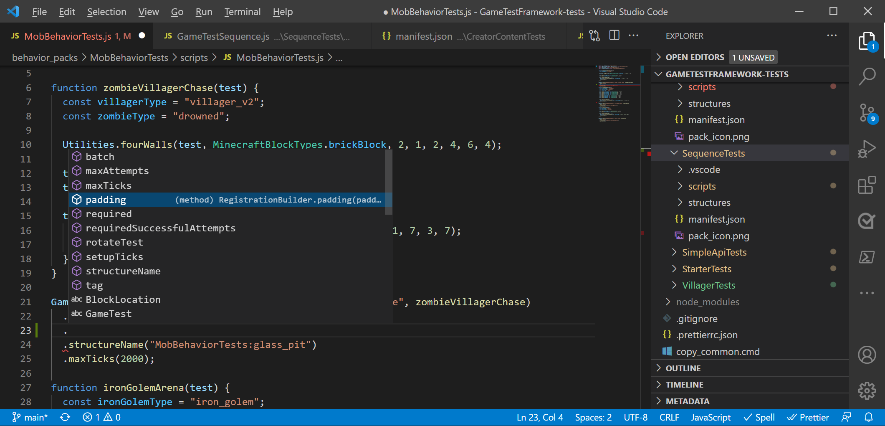
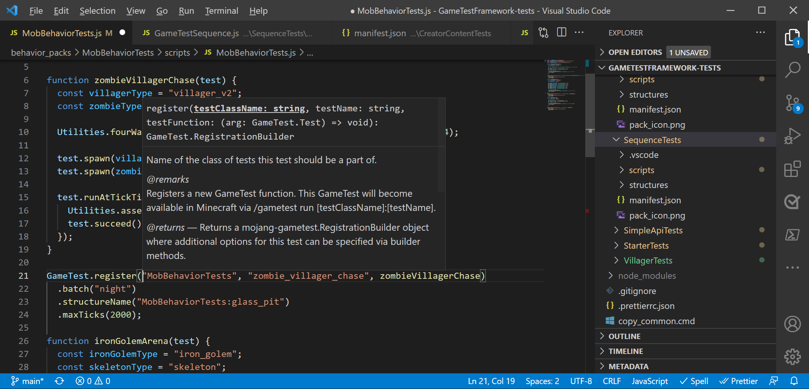

# Developer Tools for Minecraft

There are a few tools that can make the process of writing your JavaScript easier and more fun within Visual Studio Code. In this article, we'll discuss how you can install custom type definitions for Minecraft to provide autocomplete as you work, the Minecraft Script Debugger with breakpoint debugging, the Script Profiler for performance analysis, and visual debugging utilities for in-world debugging.

> [!TIP]
> In the GitHub repository at <https://github.com/microsoft/minecraft-scripting-samples>, there are various starter samples and examples that come with these tools pre-configured, so if you start your project using those, a lot of the configuration work is already done for you.

## Custom type definition files for Visual Studio Code Intellisense

Visual Studio Code can display detailed type information for different libraries to provide hints and code-completion dropdowns as you type. Type information has been made available for scripting modules `@minecraft/server`,`@minecraft/server-ui`, and several beta modules such as `@minecraft/server-gametest`.

To get started, use the Node Package Manager, or NPM. NPM makes it easy to download and install different modules of code within your packages. Install Node.js (which includes NPM) on your development device. More info on installing NPM is available from [nodejs.org](https://nodejs.org). Install the latest LTS version of Node.js to get started.

Once Node.js is installed, getting the latest type definitions is a snap. From Visual Studio Code, open the folder where your behavior pack folder is located and simply run the following commands from a terminal console window:

```powershell
npm i @minecraft/server
npm i @minecraft/server-gametest
```

This will install type definitions in the **node_modules** folder within your project.

To edit with new code hinting, just open up Visual Studio Code. As you write JavaScript, you should see it autocomplete:



and inline reference documentation for types:



>[!Note]

> We are updating these type definitions to match the latest APIs, so be sure to check NPM often to see if there are updated type definitions.

If you wish to access the latest beta API versions of modules, you can use the `@beta` version signifier:

```powershell
npm i @minecraft/server@beta
npm i @minecraft/server-ui@beta
```

## The Debug-Utilities module

The `@minecraft/debug-utilities` module lets you render visual debug information directly in the game world. These tools are particularly useful for debugging spatial logic, entity behaviors, and world interactions.

### Visual debug shapes

- **DebugBox**: Render wireframe boxes to visualize collision bounds, regions, or areas of interest
- **DebugSphere**: Display spherical debug markers for radius-based calculations
- **DebugLine**: Draw lines between points to visualize connections, paths, or directions
- **DebugArrow**: Show directional indicators for vectors, movement, or facing directions
- **DebugCircle**: Render circular indicators for range or area effects
- **DebugText**: Display text labels in 3D world space for labeling objects or showing values

See [Debugging Scripts in Minecraft](./debugging-scripts.md#drawing-debug-shapes) for example code.

### Runtime monitoring

- **Runtime Statistics**: Use `collectRuntimeStats()` to gather memory usage and performance metrics for script runtimes
- **Plugin Statistics**: Use `collectPluginStats()` to collect type usage stats for each active script plugin/add-on
- **Watchdog Controls**: Use `disableWatchdogTimingWarnings()` to control performance warning thresholds

For more details, consult the [`debug-utilities` reference page](../../ScriptAPI/minecraft/debug-utilities/minecraft-debug-utilities.md).

## The Diagnostics module

The `@minecraft/diagnostics` module provides Sentry integration for comprehensive error tracking and monitoring:

```javascript
import { sentry } from '@minecraft/diagnostics';

// Initialize error tracking
sentry.initialize({
    dsn: 'your-sentry-dsn',
    environment: 'development'
});

// Capture errors with context
try {
    // Your script logic
} catch (error) {
    sentry.captureException(error, {
        level: SentryEventLevel.Error,
        extra: { customData: 'debugging info' }
    });
}
```

For more details, consult the [`diagnostics` reference page](../../ScriptAPI/minecraft/diagnostics/minecraft-diagnostics.md).


## Summary

That's it! Between updated code helpers as you add lines of JavaScript or TypeScript, the extensive debugging and profiling capabilities within Visual Studio Code, and the visual debugging and diagnostics tools, we hope you'll be able to build, debug, and optimize complex creations in Minecraft: Bedrock Edition much more quickly.

For more debugging strategies and common error patterns, see [Debugging Scripts in Minecraft](./debugging-scripts.md).
