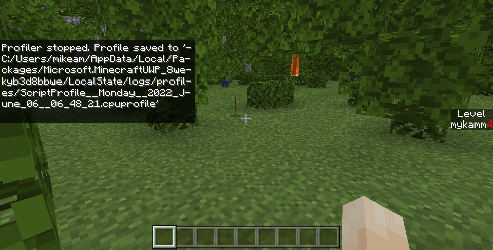
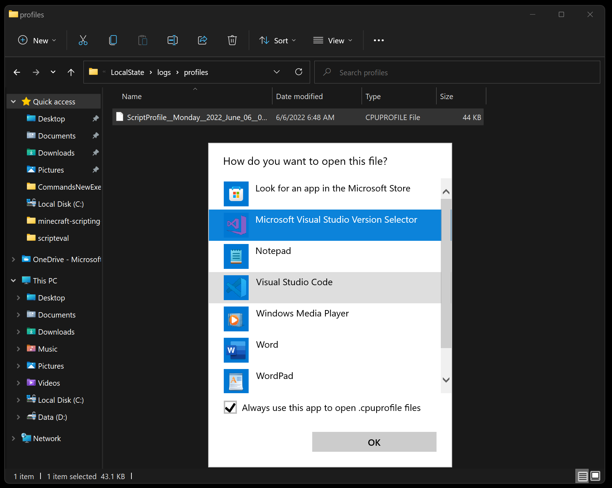
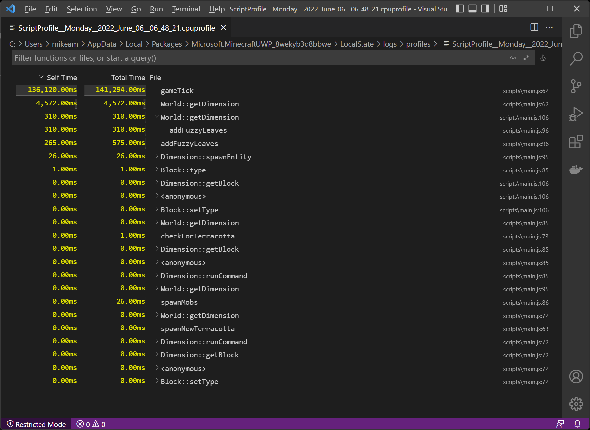
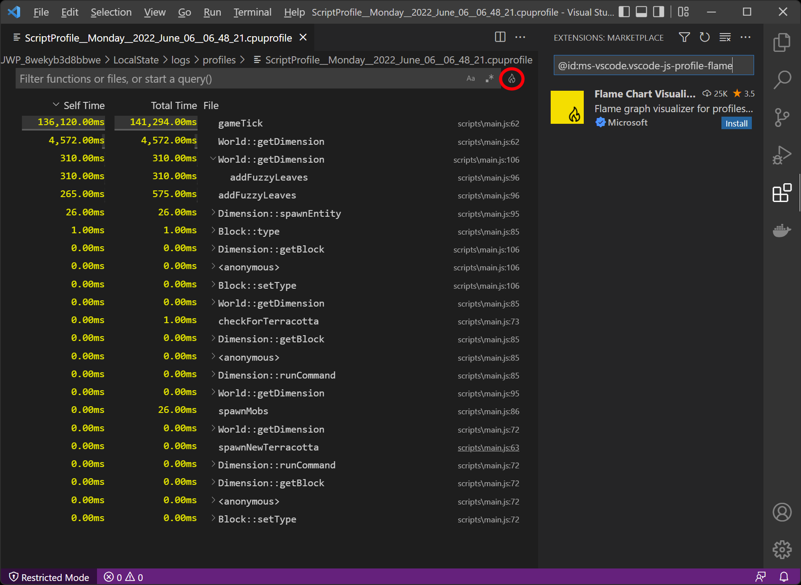

# Performance in Scripting

Performance in Minecraft scripting is about using the available time in each game tick efficiently. Scripts share game resources with simulation, rendering, entities, and other systems, so work that takes too long can cause delayed behavior, reduced responsiveness, or watchdog warnings.

Performance problems can be caused by a single expensive operation, by doing a small operation too often, or by processing more data than necessary. This article describes how to profile scripts, recognize common performance pitfalls, and improve code by measuring where time is spent before making targeted changes.

## Sections
- [Prerequisites](#prerequisites)
- [Script Profiling](#script-profiling)
  - [Run the profiler during a typical session for your script](#run-the-profiler-during-a-typical-session-for-your-script)
  - [Reading profiler results](#reading-profiler-results)
- [Common Pitfalls](#common-pitfalls)
  - [Too many native calls](#too-many-native-calls)
  - [Processing too much data at once](#processing-too-much-data-at-once)
  - [Processing too frequently or not using events](#processing-too-frequently-or-not-using-events)
  - [Spawning too many mobs or entities](#spawning-too-many-mobs-or-entities)
  - [Using too many ticking areas](#using-too-many-ticking-areas)
  - [General programming mistakes](#general-programming-mistakes)
- [Improving Performance](#improving-performance)
  - [Reducing Native Calls](#reducing-native-calls)
  - [Loop Optimization](#loop-optimization)
  - [Event filters](#event-filters)
  - [Single Tick Spikes](#single-tick-spikes)
- [Related resources](#related-resources)

## Prerequisites

Before diving into performance investigation, you should be familiar with:

- [Introduction to Scripting](./introduction.md)
- [Developer Tools for Minecraft](./developer-tools.md)
- [Debugging Scripts in Minecraft](./debugging-scripts.md)

## Script Profiling

When your script runs slowly, the profiler helps identify bottlenecks. It allows you (via commands) to define a timespan that is used to monitor performance.

A profiler is a monitoring tool that measures the amount of time spent running various functions. With it, you can identify where most of your time is spent within your scripts. This may then lead you to discovering unexpected function calling patterns that may consume a lot of time.


#### Run the profiler during a typical session for your script

To get started, ensure you have a behavior pack with JavaScript within it. Your first step is to create a profile session, or in other words, log the performance characteristics of your script as you play through the game.

To run the script profiler and start a new profile session, run the following command:

```text
/script profiler start
```

Then, exercise your code by running through and playing Minecraft. You'll want to go through normal gameplay or testing patterns to have your JavaScript exercised in representative ways of how players might encounter your experience.

After a while (several minutes, perhaps), end your profiler session by running the following command:

```text
/script profiler stop
```

This will create a **.cpuprofile** file with a timestamp within your Minecraft log folder.



For GDK builds of Minecraft (version 1.21.120+), the log folder is located at:

`%APPDATA%\Minecraft Bedrock\logs\`

To view a CPUProfile, simply open it within Visual Studio Code. The first time you open a CPUProfile file, your operating system will ask you how you wish to open the file. Select Open in [Visual Studio Code](https://code.visualstudio.com):



(Note that if you wish to have source links from the profile resolve to your source files correctly, start Visual Studio Code (or set its working directory) within the root of your behavior pack.)

By default, this will give you a simple visual listing of the functions that were called during your CPU Profile session, and the cumulative time that they have taken:



As a developer, you can start to optimize your code to adjust for performance - in this case, perhaps organizing code to share instances of a dimension object rather than repeatedly calling world.getDimension.

Note that within Visual Studio Code, you can install an optional "Flame Chart" plugin by clicking the little flame icon in the upper right of your screen (circled in red, below):



Note: In versions 1.19.10 and beyond, the script profiler has been expanded to support coverage of core Bedrock API calls in addition to overall function calls.

With this profiler capability, you can quickly identify hotspots and where server time is spent, and spend your time optimizing your code where it matters.


### Reading profiler results

The profiler shows:

- Function names: Which functions were called
- Self time: Time spent in the function itself
- Total time: Time including called functions
- Call count: How many times the function ran

Look for:

- Functions with high total time
- Functions called more often than expected
- Unexpected API calls that consume time

## Common Pitfalls

### Too many native calls

Native calls request work from the Minecraft engine, such as querying entities, accessing dimensions, or modifying blocks. Although an individual call may be inexpensive, repeatedly making native calls in a loop or on every tick can add significant overhead. Cache values that do not change, filter queries to return only the data you need, and avoid requesting the same information multiple times. See [Reducing Native Calls](#reducing-native-calls) for examples.
This is one of the most important considerations when looking at performance with scripting in Minecraft.

### Processing too much data at once

Processing a large amount of data in one tick can create a single-tick spike. For example, iterating over millions of blocks or entities in one operation can delay other game work and make the experience unresponsive. Divide large jobs into smaller batches and process them over multiple ticks or frames. See [Single Tick Spikes](#single-tick-spikes) for more information.

### Processing too frequently or not using events

Code that runs more often than necessary can waste time even when each individual operation is inexpensive. Avoid checking every frame whether a plant has grown or repeatedly scanning for an entity that has been killed when an appropriate event can notify your script of the change. Use event subscriptions when they are available, such as the entity death event, and use an appropriately spaced interval for state checks that do not have a corresponding event. [Loop Optimization](#loop-optimization) provides an example of reducing the frequency of repeated work.

### Spawning too many mobs or entities

Mobs and other entities require resources for their behavior, components, movement, rendering, and interactions with the world. Spawning large numbers of entities, especially on every tick or without removing them, can reduce performance quickly. Set reasonable limits, spawn only the entities that are needed, and clean up temporary entities when they are no longer required.

### Using too many ticking areas

Ticking areas keep parts of the world active so that simulation can continue even when players are not nearby. They can be expensive because the loaded areas continue to process blocks, entities, and other world activity. Use only the ticking areas that your experience needs, keep them as small as possible, and remove them when they are no longer required.

### General programming mistakes

Standard programming patterns can also create unnecessary work. Common examples include copying large arrays or objects, repeatedly creating or manipulating strings, iterating through very large loops, allocating temporary objects unnecessarily, and allowing work to grow without a limit. Prefer bounded work, reuse values when appropriate, process large collections in batches, and use the profiler to confirm which changes improve performance.

## Improving Performance

Take advantage of filtering in API calls that support it, so only the objects you're interested in are returned rather than filtering within your script's loop. For instance, if you're only searching for zombies around the player, ask specifically for them in your `getEntities` call.

#### Reducing Native Calls
Whenever possible, you will want to store data and variables that you get from native so that you can avoid re-fetching them. Calls in to native (Minecraft) take time and require some special back and forth handling, so it is best to reduce those as much as possible. Here is an example of this: the `getEntities` call is relatively time-consuming; you want to fetch its value _outside_ your loop, and use the cached value. If you know a value won't change (such as the Overworld dimension itself), it can be moved entirely out of the `runInterval` call:

```javascript
// ❌ SLOW: Fetching the dimension every time within the runInterval
system.runInterval(() => {
  const overworld = world.getDimension("overworld");
  overworld.spawnEntity('minecraft:experience_orb', { x: i * 10, y: 10, z: 0 });
}, 1);

// ✅ BETTER: Fetch and cachce the dimension first, outside of the runInternval
const overworld = world.getDimension("overworld");
system.runInterval(() => {
  overworld.spawnEntity('minecraft:experience_orb', { x: i * 10, y: 10, z: 0 });
}, 1);
```

The same applies for data in loops or other places where you need to get the same thing from native multiple times:
```javascript
// ❌ SLOW: Fetching the dimension within the loop (100 times)
for( var i = 0; i < 100; ++i) {
    const overworld = world.getDimension("overworld");
    overworld.spawnEntity('minecraft:experience_orb', { x: i * 10, y: 10, z: 0 });
}

// ✅ BETTER: Fetch the dimension first, outside of the loop
const overworld = world.getDimension("overworld");
for( var i = 0; i < 100; ++i) {
    overworld.spawnEntity('minecraft:experience_orb', { x: i * 10, y: 10, z: 0 });
}
```

#### Loop Optimization
```javascript
// ❌ SLOW: Processing all entities every tick
system.runInterval(() => {
  const entities = overworld.getEntities();
  for (const entity of entities) {
    // Process every entity...
  }
}, 1);

// ✅ BETTER: Filter entities and reduce frequency
system.runInterval(() => {
  const zombies = overworld.getEntities({
    type: "minecraft:zombie",
    maxDistance: 50,
    location: player.location
  });
  for (const zombie of zombies) {
    // Just process every zombie...
  }
}, 20); // Every second instead of every tick
```


#### Event filters

Some event signals support options that filter which events are delivered to your callback. Use these options when they are available instead of subscribing to every event and filtering the results in your script. Filtering at the event subscription can reduce native-to-script calls and makes the callback simpler because it only receives events that are relevant to your scenario.

For example, `EntityHitBlockAfterEventSignal` accepts `EntityEventOptions`. The following subscription only receives events for arrows that hit a block:

```javascript
import { world } from "@minecraft/server";

world.afterEvents.entityHitBlock.subscribe((event) => {
  // This callback only runs when an arrow hits a block.
  const { entity, block } = event;
  // Handle the hit...
}, {
  entityTypes: ["minecraft:arrow"]
});
```

`EntityEventOptions` can also filter some events to a specific collection of entity instances by using `entities`. Not all event signals support options, and the available options vary by event, so check the `subscribe` method in the relevant API reference before using them. For more information, see [EntityEventOptions](../../ScriptAPI/minecraft/server/EntityEventOptions.md) and [EntityHitBlockAfterEventSignal](../../ScriptAPI/minecraft/server/EntityHitBlockAfterEventSignal.md).


#### Single Tick Spikes

A single-tick spike occurs when a script performs more work in one tick than the device can handle comfortably. For example, processing a large structure or iterating over millions of blocks in one loop can delay other game systems, cause visible stuttering, or trigger a watchdog warning.

For operations that do not need to finish immediately, divide the work into smaller batches and continue on later ticks. In Bedrock, script scheduling is measured in ticks rather than render frames. 

The following example keeps a queue of blocks and processes only a fixed number of blocks on each tick:
```javascript
import {
  BlockPermutation,
  system,
  world
} from "@minecraft/server";

const blocksPerTick = 20;
const blocksToProcess = [];
let nextBlockIndex = 0;
let isProcessing = false;
const plankPermutation = BlockPermutation.resolve("minecraft:planks");

function queueBlocks(locations) {
  blocksToProcess.push(...locations);

  if (!isProcessing) {
    isProcessing = true;
    system.run(processBlockQueue);
  }
}

function processBlockQueue() {
  const overworld = world.getDimension("overworld");
  const endIndex = Math.min(
    nextBlockIndex + blocksPerTick,
    blocksToProcess.length
  );

  for (; nextBlockIndex < endIndex; nextBlockIndex++) {
    const block = overworld.getBlock(blocksToProcess[nextBlockIndex]);
    if (block) {
      block.setPermutation(plankPermutation);
    }
  }

  if (nextBlockIndex < blocksToProcess.length) {
    // Continue the remaining work on a later tick.
    system.run(processBlockQueue);
  } else {
    blocksToProcess.length = 0;
    nextBlockIndex = 0;
    isProcessing = false;
  }
}

// Add block locations when a large operation needs to be performed.
const locationsToProcess = [
  { x: 0, y: 64, z: 0 },
  { x: 1, y: 64, z: 0 },
  { x: 2, y: 64, z: 0 }
];
queueBlocks(locationsToProcess);
```

The number of operations to perform per tick is a performance tradeoff. A larger batch finishes sooner but increases the work done in each tick; a smaller batch keeps each tick responsive but takes longer to finish. Choose a batch size appropriate for the operation and verify the result on the devices that your experience supports. For long-running work that does not need to finish on a specific tick, consider using [`system.runJob`](./system-run-guide.md#the-systemrunjob-method), which yields generator work as time is available each tick.

The following example shows a simple runJob example that calls setPermutation on a large area.
```javascript
function* BlockPlacingGenerator(blockName: string, size: number, startX: number, startY: number, startZ: number) {
    const overworld = world.getDimension('overworld');
    const perm = BlockPermutation.resolve(blockName);
    for (let x = startX; x < startX + size; x++) {
        for (let y = startY; y < startY + size; y++) {
            for (let z = startZ; z < startZ + size; z++) {
                const block = overworld.getBlock({ x: x, y: y, z: z });
                if (block) {
                    block.setPermutation(perm);
                }
                yield;
            }
        }
    }
}

const genId = system.runJob(
    BlockPlacingGenerator(
        'minecraft:air',
        20,
        player.location.x + player.getViewDirection().x * 5,
        player.location.y + player.getViewDirection().y * 5,
        player.location.z + player.getViewDirection().z * 5
    )
);
```

The following example utility code demonstrates setting up a generic 'worker' which executes an operation over multiple game ticks via a BlockLocationIterator.
```javascript
const MaxBlockOp = 100;

function* workerGenerator(
    jobCompleted: () => void,
    jobFailed: (e?: unknown) => void,
    blockIterator: BlockLocationIterator,
    operation: (blockLocation: Vector3) => void
) {
    try {
        let opCount = 0;
        for (const iteratorPos of blockIterator) {
            operation(iteratorPos);
            ++opCount;
            if (opCount > MaxBlockOp) {
                opCount = 0;
                yield;
            }
        }
    } catch (e) {
        jobFailed(e);
    }

    jobCompleted();
}

export async function executeLargeOperation(
    blockLocationIterator: BlockLocationIterator,
    operation: (blockLocation: Vector3) => void
) {
    await new Promise<void>(function (resolve, reject) {
        system.runJob(workerGenerator(resolve, reject, blockLocationIterator, operation));
    });
}
```

NOTE:
The value used within MaxBlockOp is not an exact science. 1 or 10 would work, but they would maximize the trips from native to script but 1000 is too many per frame (depending on the operation). Granularity allows the job system to better scale the number of iterations per tick based on device performance. Consider playing with this value or allow it to be passed in as a parameter so it can be tweaked depending on the job required.

## Related resources

- [Developer Tools for Minecraft](./developer-tools.md)
- [Debugging Scripts in Minecraft](./debugging-scripts.md)
