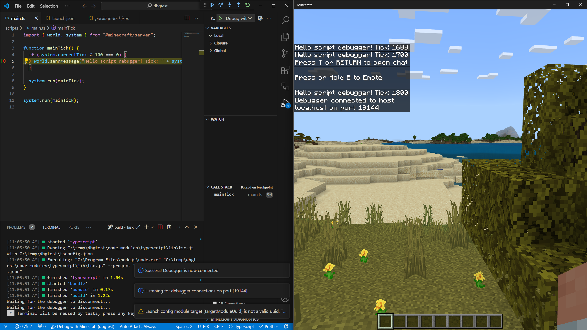
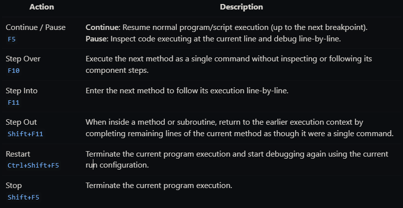
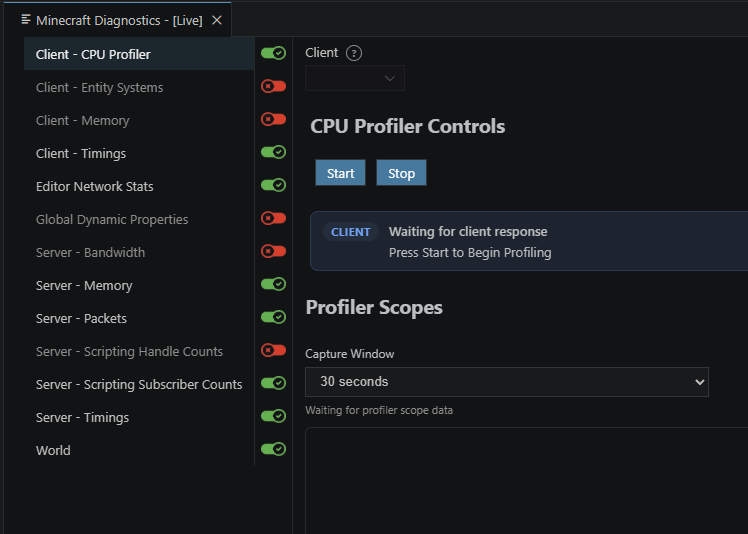
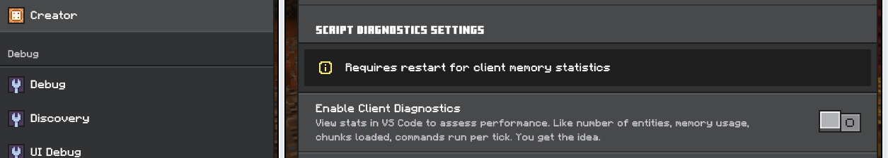
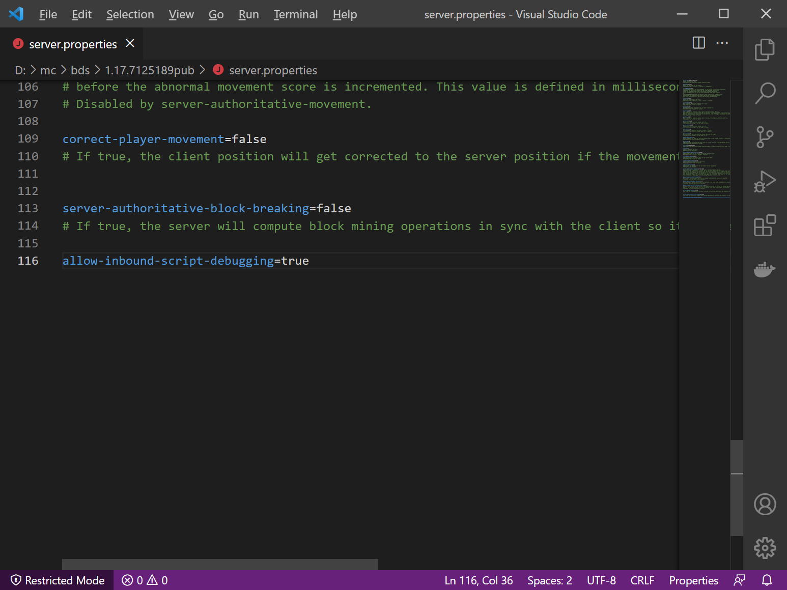
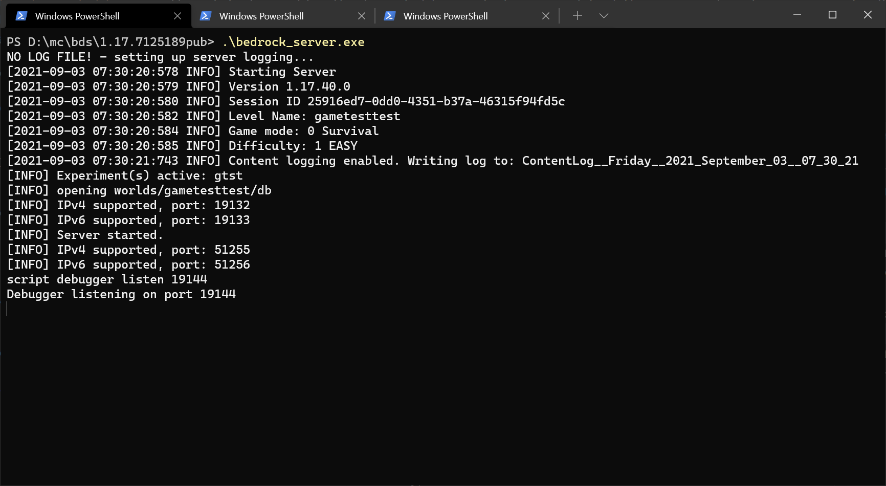

# Minecraft VS Code Debugger

## Overview

The Minecraft Bedrock Edition Debugger extension for Visual Studio Code helps you inspect and troubleshoot script behavior while your content is running. You can pause execution at breakpoints, step through JavaScript or TypeScript one line at a time, inspect variables, evaluate expressions, and monitor live diagnostics from Minecraft.

This article explains how to connect the debugger to Minecraft Bedrock Edition or Bedrock Dedicated Server, configure your project, and use common debugging features to investigate script behavior and performance.

## Sections
- [Prerequisites](#prerequisites)
- [Using the Visual Studio Code debugger](#using-the-visual-studio-code-debugger)
  - [Debugging with Minecraft Bedrock Edition](#debugging-with-minecraft-bedrock-edition)
    - [Step 1: Install the Minecraft Bedrock Edition Debugger within Visual Studio Code](#step-1-install-the-minecraft-bedrock-edition-debugger-within-visual-studio-code)
    - [Step 2: Open Visual Studio Code within your development_behavior_packs folder](#step-2-open-visual-studio-code-within-your-development_behavior_packs-folder)
    - [Step 3: Prepare Visual Studio Code for a connection](#step-3-prepare-visual-studio-code-for-a-connection)
    - [Run your Minecraft Behavior Pack](#run-your-minecraft-behavior-pack)
  - [Live Diagnostics](#live-diagnostics)
    - [Enable client diagnostics](#enable-client-diagnostics)
  - [Debugging with Minecraft Bedrock Dedicated Server](#debugging-with-minecraft-bedrock-dedicated-server)
    - [Configure your Bedrock Dedicated Server](#configure-your-bedrock-dedicated-server)
  - [Quick setup checklist](#quick-setup-checklist)
  - [Debugging techniques](#debugging-techniques)
    - [Setting breakpoints](#setting-breakpoints)
    - [Conditional breakpoints](#conditional-breakpoints)
    - [Watch expressions](#watch-expressions)
    - [The debug console](#the-debug-console)
  - [Debugging tips](#debugging-tips)
  - [Debugger commands](#debugger-commands)
- [Related resources](#related-resources)

## Prerequisites

Before diving into debugging, you should be familiar with:

- [Introduction to Scripting](./introduction.md)
- [Developer Tools for Minecraft](./developer-tools.md)

## Using the Visual Studio Code debugger


As you build more of a code base in script, you'll want to inspect your code at various points to see the state of variables and test your algorithms. In many starter projects, people start by using commands like Console.log or Chat to print various variables as they go – informally, this is called "print debugging". But for developers, there is a better way! With scripting in Minecraft Bedrock Edition, you can use script debugging capabilities. The Visual Studio Code debugger lets you look at live diagnostics, execute commands, pause execution, inspect variables, and step through code line by line.

To get started, you'll want to use Visual Studio Code as your editor for the JavaScript files you've been developing. Steps from there include:

1. Install the Minecraft Bedrock Edition Debugger within Visual Studio Code – you'll need to do this once
1. Open Visual Studio Code within your development_behavior_packs folder
1. Depending on your testing client - either in Bedrock Dedicated Server or within Minecraft Bedrock clients -- connect Minecraft Bedrock Edition and Visual Studio Code
1. Set break points and add watch variables in your code as you go, and then connect Minecraft to Visual Studio Code

### Debugging with Minecraft Bedrock Edition

#### Step 1: Install the Minecraft Bedrock Edition Debugger within Visual Studio Code

To use debugger capabilities, you'll want to install the Minecraft Bedrock Edition Debugger within Visual Studio Code. To do this, please click on the button below to download the **Minecraft Bedrock Edition Debugger** from Visual Studio Code's marketplace.

> [!div class="nextstepaction"]
> [Minecraft Bedrock Edition Debugger](https://aka.ms/vscodescriptdebugger)

#### Step 2: Open Visual Studio Code within your development_behavior_packs folder

In order for the debugger to know where to find your source JavaScript or TypeScript files, you'll need to specifically open up a window of Visual Studio Code relative to the behavior pack, or addon, where your JavaScript or TypeScript source files are. This may be inside of Minecraft's development behavior packs folder (e.g., `%APPDATA%\Minecraft Bedrock\users\shared\games\com.mojang\development_behavior_packs` for GDK builds), or you may have your source code located in a separate folder (e.g., `c:\projects\myaddon`). (See [GDK Migration on Windows](./../GDKPCProjectFolder.md) for more details on folder locations, including pre-GDK builds.)

#### Step 3: Prepare Visual Studio Code for a connection

To debug with Minecraft Bedrock Edition, you'll need to connect from Minecraft and into Visual Studio Code. This set of steps assumes you are debugging on the same Windows machine that you are running Minecraft from, but you can also debug across machines and across clients if you want to. If you are debugging across devices, you may need to open up a port within your firewall on the machine that you are running Visual Studio Code within.

You'll want to configure Visual Studio Code to know how to connect to Minecraft. If you're using a sample project such as the TS starter <https://github.com/microsoft/minecraft-scripting-samples/tree/main/ts-starter>, this **.vscode/launch.json** file is already configured for you. But if you're creating a project from scratch, follow these instructions:

At the root of the behavior pack you want to debug, add a **.vscode** subfolder. Add the following **launch.json** file into that **.vscode** folder.

If your source is in JavaScript and you are developing directly against that source (you do not use a script build process), you'll want to configure **launch.json** as follows:

```json
{
  "version": "0.3.0",
  "configurations": [
    {
      "type": "minecraft-js",
      "request": "attach",
      "name": "Debug with Minecraft",
      "mode": "connect",
      "preLaunchTask": "build",
      "targetModuleUuid": "<YOUR TARGET MODULE ID HERE>",
      "localRoot": "${workspaceFolder}/",
      "port": 19144
   }
  ]
}
```

`localRoot` should point at the folder which contains your behavior pack with script within it.
Port 19144 is the default networking port for Minecraft Script Debugging.

In the example above, `targetModuleUuid` is an optional parameter that specifies the identifier of your script module, which is located in your behavior pack's **manifest.json** file. This is important to use if you are developing add-ons in Minecraft while there are multiple behavior packs with script active.

If your source is in a language like TypeScript that generates JavaScript for Minecraft, you will want to use `sourceMapRoot` and `generatedSourceRoot` parameters in **launch.json**:

```json
{
  "version": "0.3.0",
  "configurations": [
    {
      "type": "minecraft-js",
      "request": "attach",
      "name": "Debug with Minecraft",
      "mode": "connect",
      "preLaunchTask": "build",
      "targetModuleUuid": "<YOUR TARGET MODULE ID HERE>",
      "sourceMapRoot": "${workspaceFolder}/dist/debug/",
      "generatedSourceRoot": "${workspaceFolder}/dist/scripts/",
      "port": 19144
   }
  ]
}
```

Note that `generatedSourceRoot` should point at a folder where your generated JavaScript files (*.js) are stored, for example, the outputs of a TypeScript build process. `sourceMapRoot` should point at a folder where you have source map files&mdash;typically created during your build process&mdash;that tie your generated JavaScript source files back to your potential TypeScript source.

#### Run your Minecraft Behavior Pack

Now that you've prepared Visual Studio Code and prepared your behavior pack, you're ready to start debugging!

Within Visual Studio Code, click the "Debug with Minecraft" option under the Run menu (or hit F5) to start debugging. This will place Visual Studio Code into "Listen Mode", where it awaits a connection from Minecraft.

Start Minecraft and load into a world with your scripting behavior pack.

Use this slash command to connect Minecraft to Visual Studio Code:

```text
/script debugger connect
```

You should see a "Debugger connected to host" response from this command if the connection is successful.



You can set breakpoints in your code by clicking on the left-hand side of the editor, on specific lines of code. As you run the tests in the behavior pack, your breakpoints should be hit. You can then use standard breakpoint debugging techniques to debug your code. This includes the following actions:


More specific VS Code debugging info can be viewed at [Debug code with Visual Studio Code](https://code.visualstudio.com/docs/debugtest/debugging).

You can also view local variables and add watches as necessary.

### Live Diagnostics

Live diagnostics provide continuously updated information about Minecraft while a debugger session is active. You can use live diagnostics without selecting a specific behavior pack. However, some diagnostics are scoped to an individual pack, such as scripting handle counts. When a diagnostic is pack-scoped, select the pack from the pack selector in the diagnostics view.

Minecraft sends live diagnostic updates on a tick basis. Individual diagnostics can update at different frequencies, so some values may refresh more often than others. To reduce the amount of data sent during a debugging session, use the toggle next to each diagnostics tab to enable or disable it. These selections are saved and persist between debugging sessions.



You can add custom live diagnostics tabs, displays, and data from a script. The `@minecraft/debug-utilities` module provides the diagnostics manager and APIs for creating and manipulating custom diagnostics tabs and views. For more information, see the [Debug Utilities API Reference](../../ScriptAPI/minecraft/debug-utilities/minecraft-debug-utilities.md).

#### Enable client diagnostics

Client diagnostics require the **Enable Client Diagnostics** creator debug setting to be enabled in the Minecraft client. In Minecraft, open the creator debug settings, locate **Enable Client Diagnostics**, and turn it on before connecting the debugger. Some client statistics, including client memory statistics, may require you to restart the client after enabling the setting.



### Debugging with Minecraft Bedrock Dedicated Server

The procedure for debugging with Bedrock Dedicated Server is a little different. When debugging with Bedrock Dedicated Server, Bedrock Dedicated Server (not Visual Studio Code) will listen for debug connections initiated from Visual Studio Code. You'll want to start by installing the Minecraft Bedrock Edition Debugger for Visual Studio Code as described above.

#### Configure your Bedrock Dedicated Server

By default, Bedrock Dedicated Servers are not configured to allow debug connections. To enable this debugging, you'll need to change some settings within the `server.properties` file of your Bedrock Dedicated Server.

These settings configure debugging on Bedrock Dedicated Server:

- `allow-outbound-script-debugging` (true/false): enables the `/script debugger connect` command. Defaults to `false`.
- `allow-inbound-script-debugging` (true/false): enables the `/script debugger listen` command (and the opening of ports on a server).  Defaults to `false`.
- `force-inbound-debug-port` (number): Locks the inbound debug port to a particular port. This will set the default script debugging port and prevent a user of the `/script debugger listen` command from specifying an alternate port.



Within Bedrock Dedicated Server's console, use this slash command to start listening on a port:

```text
/script debugger listen 19144
```

You should see a "Debugger listening" response from this command.



Within Visual Studio Code, you'll want to configure your debug settings in **launch.json** to have Visual Studio connect to Dedicated Server. To do this, set `mode` to `connect`.

```json
{
    "version": "0.3.0",
    "configurations": [
      {
        "type": "minecraft-js",
        "request": "attach",
        "name": "Debug with Minecraft",
        "mode": "connect",
        "preLaunchTask": "build",
        "sourceMapRoot": "${workspaceFolder}/dist/debug/",
        "generatedSourceRoot": "${workspaceFolder}/dist/scripts/",
        "port": 19144
      }
    ]
  }
```

Now, click **Start Debugging** inside of Visual Studio Code.

As with when you debug against Minecraft clients, you can set breakpoints in your code by clicking on the left-hand side of the editor, on specific lines of code.


### Quick setup checklist

1. Install the debugger extension: [Minecraft Bedrock Edition Debugger](https://aka.ms/vscodescriptdebugger)

2. Create **launch.json** in your **.vscode** folder:

   ```json
   {
       "version": "0.3.0",
       "configurations": [
           {
               "type": "minecraft-js",
               "request": "attach",
               "name": "Debug with Minecraft",
               "mode": "connect",
               "localRoot": "${workspaceFolder}/",
               "port": 19144
           }
       ]
   }
   ```

3. Start debugging in VS Code (F5), then connect from Minecraft:

   ```text
   /script debugger connect
   ```

### Debugging techniques

#### Setting breakpoints

Click in the gutter (left margin) of your code to set breakpoints. When execution reaches that line, Minecraft pauses and Code shows the current state:


#### Conditional breakpoints

Right-click on a breakpoint to add a condition. The breakpoint only triggers when the condition is true:

```javascript
// Only break when player health is low
player.getComponent("health").currentValue < 5
```

#### Watch expressions

In the Watch panel, add expressions to monitor, such as:

- `player.name`
- `entity.location`
- `myVariable > 10`

#### The debug console

While paused, use the Debug Console to evaluate expressions:

```javascript
> world.getAllPlayers().length
2
> player.dimension.id
"minecraft:overworld"
```

### Debugging tips

1. Start simple: Begin with one breakpoint at the suspected problem area.
2. Step through slowly: Use F10 (Step Over) to execute one line at a time.
3. Check assumptions: Use the Watch panel to verify your assumptions about variable values.
4. Look at the call stack: The Call Stack panel shows how you got to the current line.

#### Debugger commands

- `/script debugger connect [host] [port]` - Connect to a debugger session
- `/script debugger listen <port>` - Start listening for debugger connections  
- `/script debugger close` - Close debugger connection

## Related resources

- [Developer Tools for Minecraft](./developer-tools.md)
- [Content Error Log](../ContentErrorLog.md)
- [Building Debug Tools](../../Casual/DebugTools.md)
- [Debug Utilities API Reference](../../ScriptAPI/minecraft/debug-utilities/minecraft-debug-utilities.md)
